<div align="center">

```
 ____  _   _ ___ _____ _     ____
/ ___|| | | |_ _| ____| |   |  _ \
\___ \| |_| || ||  _| | |   | | | |
 ___) |  _  || || |___| |___| |_| |
|____/|_| |_|___|_____|_____|____/
```

**S**emantic and **H**ierarchical **I**nference for **E**xploits and **L**ogic **D**etection

*Find the vulnerability. Name the CWE. Propose a fix. Prove the fix is sane.*

`Python 3.12` · `Joern 4.0.647` · `CodeBERT` · `PyTorch Geometric` · `XGBoost` · `Docker` · `pytest + ruff CI`

</div>

---

> **How to read this README.** It documents the repository **as it exists today**.
> Every component carries a status badge, so you can tell at a glance what runs, what is a prototype,
> and what is still on the roadmap. The roadmap and every settled decision live in
> [`SHIELD_PLAN.md`](SHIELD_PLAN.md). This README is the *map of the code*.
> When you add or change something, update the matching section here (see [Keeping this README current](#18-keeping-this-readme-current)).

| Badge | Meaning |
| :---: | --- |
| ✅ | **Working and tested.** Safe to build on. |
| 🟡 | **Partial or prototype.** Runs, but is incomplete, not wired in, or only a script. |
| 🧱 | **Stub.** The code path exists and returns a placeholder so the contract is stable. |
| ⬜ | **Planned.** Nothing in the repo yet. |

---

## Table of contents

1. [What is SHIELD?](#1-what-is-shield)
2. [Project status at a glance](#2-project-status-at-a-glance)
3. [Quick start](#3-quick-start)
4. [Architecture: target vs. what runs today](#4-architecture-target-vs-what-runs-today)
5. [Folder structure schema](#5-folder-structure-schema)
6. [Folder responsibilities](#6-folder-responsibilities)
7. [Functionality → folder reference table](#7-functionality--folder-reference-table)
8. [File catalog: what every file does, takes in and gives out](#8-file-catalog)
9. [Sequence flow of the files](#9-sequence-flow-of-the-files)
10. [Data flow: where input starts and where each output goes](#10-data-flow)
11. [Activity diagrams: lifecycle from start to end](#11-activity-diagrams)
12. [The public contract (`interface.py`)](#12-the-public-contract)
13. [Configuration files](#13-configuration-files)
14. [Datasets](#14-datasets)
15. [Testing and CI](#15-testing-and-ci)
16. [How to extend SHIELD](#16-how-to-extend-shield)
17. [Known gaps and sharp edges](#17-known-gaps-and-sharp-edges)
18. [Keeping this README current](#18-keeping-this-readme-current)
19. [Documentation index (`docs/`)](#19-documentation-index)
20. [Team workflow, Joern in Docker, troubleshooting](#20-team-workflow-joern-in-docker-troubleshooting)
21. [Glossary](#21-glossary)

---

## 1. What is SHIELD?

SHIELD is a **vulnerability detection system for source code**. Given a function, a file or (later) a whole
repository, it answers four questions:

| # | Question | How SHIELD answers it |
| :-: | --- | --- |
| 1 | **Is this code vulnerable?** | A classifier over CodeBERT embeddings (V1/V2), later fused with a graph neural network (V3/V4). |
| 2 | **Which weakness is it?** | The model predicts a **CWE** id (for example `CWE-89`, SQL injection) with a calibrated confidence. |
| 3 | **How does bad data get there?** | Joern builds a **code property graph**; taint queries list *source → sink* paths and whether a sanitizer sits on the path. |
| 4 | **Can it be fixed, and is the fix sane?** | Hand-written **fix templates** rewrite the code; a **verification** module checks syntax, a class-specific pattern and (later) re-detection and tests. |

### The model ladder (V1 → V4)

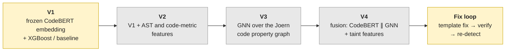

*Yellow = partially built, grey = planned. V1 is the safety net: whenever a newer model cannot load, the
model registry falls back to V1 automatically.*

### Design principles (they explain most of the folder layout)

* **Core first, product last.** The core is a Python library plus a CLI (`shield_core`). The FastAPI
  backend, Angular app and VS Code extension are thin wrappers added at the end (plan D18).
* **One frozen seam.** Everything the outside world sees goes through `shield_core/interface.py`
  (`INTERFACE_VERSION = "1.0"`). Changing it needs a Decisions Log row and a version bump (plan D34).
* **Languages are plug-ins.** A language is one YAML file in `languages/`. No other code may hard-code a
  language name; a test enforces this (plan D24).
* **No leakage, no vanity metrics.** Splits are by *project/commit group*, never random rows. Final
  metrics are blocked until split QA passes (plan D16, D33).
* **Swappable parts.** ML code never imports Joern directly; it uses the `GraphExtractor` interface (plan D2).
  Models are chosen by `models.yaml`, never hard-coded (plan D18).

---

## 2. Project status at a glance

*Plan version v1.1. Week 1 closed (Gate G1 passed with conditions). Week 2 is in progress; Gate G2 is the next gate.*

### Component maturity

| Area | Component | Status | Notes |
| --- | --- | :---: | --- |
| **Contract** | `interface.py` data classes, errors, versions | ✅ | Frozen at 1.0 |
| | `predict(code, language)` | ✅ | Real routing through language + model registries; the only registered model is the **stub** (always "not vulnerable") |
| | `scan_repo(path)` | 🧱 | Validates the path, returns an empty `RepoResult` |
| | `suggest_fix(finding)` | 🧱 | Returns `no_fix_available`; templates exist but are **not wired in yet** (task W3-P4-02) |
| **CLI** | `shield scan <file>` | ✅ | Detects language, calls `predict`, prints JSON |
| | `shield scan-repo`, `shield fix` | ⬜ | Planned (Weeks 3–4) |
| **Languages** | Registry + `python.yaml`, `cpp.yaml` | ✅ | Python and C/C++ enabled |
| | `java.yaml` | ⬜ | Present but **disabled** (decision D36) |
| **Models** | Model registry (`models.yaml`, fallback to V1) | ✅ | Only kind registered today: `stub` |
| | V1 training (`scripts/train_v1.py`) | 🟡 | Trains and evaluates; model saving and MLflow logging are still commented out; not yet registered in `models.yaml` |
| | V2 (AST/code-metric features) | ⬜ | Needs tree-sitter utilities (W2-P5-02) |
| | V3 GNN, V4 fusion | ⬜ | Only a toy GNN on MUTAG (`scripts/pyg-gnn/`) |
| **Embeddings** | `CodeBERTEmbedder` (windowed, fp16, disk cache) | ✅ | |
| | `CPGNodeEmbedder` (node text → vector) | 🟡 | In-memory cache only; no disk cache yet |
| **Data** | Loaders for 5 sources | ✅ | MegaVul, Big-Vul, CVEfixes C/C++, CVEfixes Python, Zenodo Python |
| | Unified schema 1.2 (10 columns) | ✅ | Adds `date` and `cve` to the original 8 |
| | Dedupe, merge, project-name normalization | ✅ | |
| | Group-safe splits (`splits.py`, manifest v0.2) | ✅ | train / val / test / project-disjoint holdout |
| | Split QA tool (`scripts/split_qa.py`) | ⬜ | File exists but is **empty** (W2-P5-04) |
| **Graphs** | `GraphExtractor` + Joern + cache | ✅ | Library only |
| | Batch extraction over the training subset | ⬜ | W2-P1-02 |
| | CPG → PyG converter | 🟡 | `scripts/graphml_to_pyg.py` (not yet in `shield_core/`) |
| **Taint** | Query generator from YAML | ✅ | `shield_core/taint/joern_queries.py` |
| | Taint spike driver | ✅ | `scripts/taint/run_taint_spike.py` |
| | Taint as model features | ⬜ | Week 3 |
| **Fix + verify** | Python templates: CWE-89, CWE-78, CWE-22 | ✅ | Standalone, heavily tested |
| | Verification: evidence + pattern checks | ✅ | Syntax/pattern/test logic and the D35 verdict rule |
| | Re-detection hook, sandboxed test runner | ⬜ | Week 3 |
| **Evaluation** | `eval/metrics.py` | 🟡 | Weighted aggregate P/R/F1 + confusion matrix only; per-CWE metrics owed (W2-P3-03) |
| | Run tracking (`tracking.py`) | ✅ | MLflow / W&B / console, seeds, dataset hash |
| **Infra** | Docker image with pinned Joern | ✅ | |
| | CI (ruff + format + pytest) | ✅ | |
| **Product** | FastAPI, Angular, VS Code extension | ⬜ | Weeks 5–6 |

### Gates

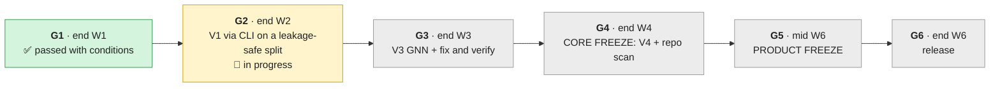

---

## 3. Quick start

**Prerequisites:** Git, Python 3.12 (CI uses it; `pyproject.toml` allows 3.10+), Docker Desktop (only for Joern; on Windows it needs WSL 2).

```bash
# 1. clone and enter
git clone https://github.com/nhahub/NHA-5-186.git
cd NHA-5-186

# 2. virtual environment
python -m venv .venv
.venv\Scripts\Activate.ps1          # Windows PowerShell
# source .venv/bin/activate         # macOS / Linux

# 3. install the project with dev tools (editable)
pip install -e ".[dev]"
pip install -e ".[data,ml]"         # datasets + CodeBERT/XGBoost stack

# 4. one-time git hooks
pre-commit install

# 5. verify your setup (all four should pass)
ruff check .
ruff format --check .
pytest
pre-commit run --all-files
```

### Try it: scan a file with the CLI

```bash
shield scan path/to/file.py
shield scan snippet.txt --language python      # override language detection
```

Today this returns the **stub** model's answer. This is real output from the current repo:

```json
{
  "vulnerable": false,
  "cwe": null,
  "confidence": 0.0,
  "findings": [],
  "taint_paths": [],
  "model_version": "stub",
  "schema_version": "1.0"
}
```

The important part is that the *whole path is real*: file → language detection → language registry →
model registry → model → frozen `Result`. When the real V1 is registered, this exact command starts
returning real predictions with **no code change** in the CLI or the interface.

### Try it: generate and verify a fix (library level, not yet wired to the CLI)

```python
from shield_core.models.fixgen import get_template
from shield_core.verify.pattern_checks import get_pattern_check
from shield_core.verify.evidence import Rating, Checks, make_report

code = """def get_user(cursor, uid):
    q = "SELECT * FROM users WHERE id = " + uid
    return cursor.execute(q)
"""
fix = get_template("sql_parameterize")(
    code, context="import sqlite3\n"
)  # context = rest of the file
print(fix.fixed_code)
# def get_user(cursor, uid):
#     return cursor.execute("SELECT * FROM users WHERE id = ?", (uid,))

ok = get_pattern_check("execute_literal_sql")(fix.fixed_code)  # True
report = make_report(
    Rating.STRONG, Checks(syntax_ok=True, redetect_ok=True, tests_ok=None, pattern_ok=ok)
)
print(report.verdict, "|", report.notes)
# PASS | [evidence] syntax=ok; redetect=true; pattern_check=ok; tests=not_run.
```

(`redetect_ok=True` is passed by hand here, because the re-detection hook is not built yet.)

### Try it: rebuild the dataset (needs the raw data in `data/raw/`)

```bash
python -m shield_core.datasets.dedupe        # loaders' parquet  ->  *_deduped.parquet + docs/dedupe_report.md
python -m shield_core.datasets.merge         # *_deduped.parquet ->  merged_datasets.parquet
python -m shield_core.datasets.splits        # merged            ->  train/val/test/holdout + manifest
python scripts/acceptance_check.py           # audit report  ->  docs/dataset_audit.md
```

---

## 4. Architecture: target vs. what runs today

### 4.1 The big picture (target end-state, today's coverage colour-coded)

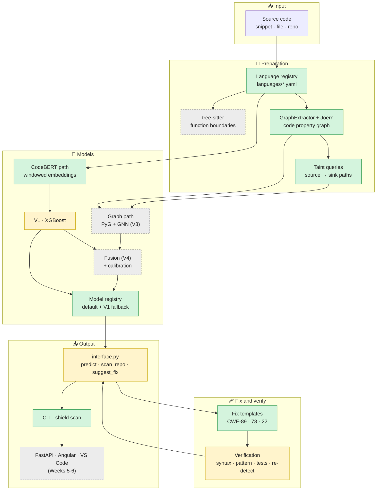

### 4.2 What actually executes when you run `shield scan` today

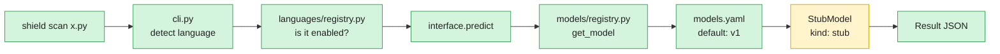

Everything is real except the model at the end of the chain. That is deliberate: it lets the CLI, tests and
contract be finished before the model is.

---
## 5. Folder structure schema

```text
SHIELD/
│
├── 📄 README.md                  ← you are here (map of the code)
├── 📄 SHIELD_PLAN.md             ← roadmap, decisions D1-D39, weekly tasks (single source of truth)
├── 📄 pyproject.toml             ← package metadata, dependencies, ruff + pytest settings, `shield` CLI entry
├── 📄 .pre-commit-config.yaml    ← local checks on every commit
├── 📄 .gitattributes / .gitignore
│
├── 🤖 .github/
│   ├── workflows/ci.yml          ← CI: ruff, format check, pytest (Python 3.12)
│   └── pull_request_template.md
│
├── 🐳 docker/joern/              ← reproducible Joern runtime
│   ├── Dockerfile                ← Java 21 + Joern 4.0.647 + tree-sitter grammars
│   ├── requirements-docker.txt   ← pinned Python packages inside the image
│   └── smoke/                    ← smoke test: parse one sample per language
│
├── 🌐 languages/                 ← LANGUAGE PLUG-INS (one YAML per language)
│   ├── registry.py               ← loads + validates the YAML files, answers "what languages exist?"
│   ├── python.yaml               ← enabled · 14 CWEs · taint sources/sinks · fix templates
│   ├── cpp.yaml                  ← enabled · C and C++ · 20 CWEs · taint config
│   └── java.yaml                 ← DISABLED (kept so enabling it later is a one-word change)
│
├── 🧠 shield_core/               ← THE CORE LIBRARY (everything importable lives here)
│   ├── interface.py              ← frozen public contract: predict · scan_repo · suggest_fix
│   ├── cli.py                    ← `shield scan <file>`
│   ├── tracking.py               ← run logging (MLflow / W&B / console), seeds, dataset hashes
│   │
│   ├── datasets/                 ← raw data → clean, de-duplicated, leakage-safe splits
│   │   ├── c_cpp_loaders/        ← MegaVul · Big-Vul · CVEfixes (C/C++)
│   │   ├── python_loaders/       ← CVEfixes (Python) · Zenodo Python
│   │   ├── schema.py             ← unified 10-column schema + validation + parquet I/O
│   │   ├── project_names.py · project_normalization.py
│   │   ├── dedupe.py · merge.py · splits.py
│   │   └── cvefixes_convert_db.py
│   │
│   ├── extraction/               ← source code → graph (Joern behind an interface)
│   │   ├── graph_extractor.py    ← GraphExtractor interface + CodeGraph/Node/Edge
│   │   ├── joern_extractor.py    ← the Joern implementation
│   │   ├── cache.py              ← disk cache keyed by code hash + versions
│   │   └── node_embeddings.py    ← CodeBERT vector per graph node (for the GNN)
│   │
│   ├── taint/                    ← taint-analysis query builder
│   │   └── joern_queries.py      ← YAML sources/sinks/sanitizers → Joern (Scala) script → parsed flows
│   │
│   ├── models/
│   │   ├── registry.py + models.yaml   ← which model answers, with automatic V1 fallback
│   │   ├── embedding/embedder.py       ← windowed CodeBERT embedder
│   │   └── fixgen/                     ← template-based fixes (CWE-89 · CWE-78 · CWE-22)
│   │
│   └── verify/                   ← "is this fix sane?" (syntax · pattern · evidence · verdict)
│
├── 📊 eval/                      ← metrics (precision / recall / F1, confusion matrix)
│
├── 🧪 tests/                     ← 27 test files · ~376 test functions
│   └── fixtures/
│       ├── joern/                ← small Python + C++ files used to study Joern output
│       └── taint/{python,c}/     ← 23 Python + 26 C/C++ taint fixtures, each with an EXPECT line
│
├── 🛠️ scripts/                   ← runnable entry points: audits, spikes, exploration, training
│   ├── train_v1.py · acceptance_check.py · graphml_to_pyg.py · try_extractor.py · demo_tracking.py
│   ├── codebert_embeddings_analysis/   ← token lengths, long-function windows, embedding jobs
│   ├── joern_spike_audit/              ← the Joern go/no-go experiment
│   ├── taint/                          ← the taint spike driver
│   ├── pyg-gnn/                        ← PyTorch Geometric lessons + toy GNN
│   └── explore/                        ← tiny inspectors for Joern GraphML exports
│
├── 📚 docs/                      ← design notes, audits, reports (see section 19)
├── 📦 requirements/              ← pinned GPU torch wheel (CUDA 12.6)
│
│   ───────── created at run time, git-ignored ─────────
├── 💾 data/
│   ├── raw/                      ← downloaded datasets (CVEfixes, MegaVul, Big-Vul, Zenodo)
│   ├── interim/                  ← parquet files in the unified schema, deduped files, splits/
│   └── cache/                    ← graph cache (data/cache/graphs) and embedding cache
├── 🗃️ artifacts/                 ← output folder of scripts/train_v1.py
├── 🗃️ model_artifacts/           ← (future) model files the registry loads; override with SHIELD_MODELS_DIR
└── 📈 mlruns/ · wandb/           ← experiment tracking
```

> Folders such as `sample1/ … sample5/` at the repo root are **local Joern experiments** (`cpg.bin`,
> `export.xml`). They are scratch space, not part of the package, and should stay out of Git.
> Later tasks will add `api/` (FastAPI), `web/` (Angular) and `vscode-ext/` (Weeks 5-6).

---

## 6. Folder responsibilities

| Folder | Responsible for | Does **not** do |
| --- | --- | --- |
| `languages/` | Declaring *what a language is*: extensions, Joern frontend, tree-sitter grammar, target CWEs, taint sources/sinks/sanitizers, fix-template metadata. | Contain any detection logic. |
| `shield_core/interface.py`, `cli.py` | The **only** entry points other code and users touch. Stable, versioned. | Know how models, Joern or datasets work internally. |
| `shield_core/datasets/` | Turning five raw datasets into **one** clean table, then into **leakage-safe** train/val/test/holdout files. | Train anything. |
| `shield_core/extraction/` | Turning code into a graph (and a graph's nodes into vectors). Caching results. | Decide whether code is vulnerable. |
| `shield_core/taint/` | Building taint queries from language configuration and parsing Joern's answers. | Run Docker itself (the driver in `scripts/taint/` does). |
| `shield_core/models/` | Selecting and loading models (registry), embedding code (CodeBERT), generating fixes (templates). | Hard-code model versions. |
| `shield_core/verify/` | Judging a proposed fix: syntax, class-specific pattern, evidence line, PASS/FAIL verdict. | Generate fixes. |
| `eval/` | Computing metrics from predictions. | Load data or models. |
| `scripts/` | One-off and repeatable *runs*: audits, spikes, exploration, V1 training. They may import `shield_core`; `shield_core` never imports them. | Hold reusable library logic long-term. |
| `tests/` | Unit tests plus fixture code for Joern and taint. | |
| `docker/joern/` | A pinned, reproducible Joern + Java + tree-sitter environment. | |
| `docs/` | Written evidence: audits, spikes, design notes, leakage reports, API contract. | |
| `data/`, `artifacts/`, `mlruns/` | Large, generated, git-ignored outputs. | |

---

## 7. Functionality → folder reference table

*"I want to … where do I look?"*

| Functionality | Lives in | Key file(s) | Status |
| --- | --- | --- | :---: |
| Scan one file from the terminal | `shield_core/` | `cli.py` | ✅ |
| Call the detector from Python | `shield_core/` | `interface.py` → `predict()` | ✅ |
| Know which languages are enabled / detect language from a path | `languages/` | `registry.py`, `*.yaml` | ✅ |
| Choose, load and fall back between models | `shield_core/models/` | `registry.py`, `models.yaml` | ✅ |
| Embed code with CodeBERT (incl. long functions) | `shield_core/models/embedding/` | `embedder.py` | ✅ |
| Embed graph nodes with CodeBERT | `shield_core/extraction/` | `node_embeddings.py` | 🟡 |
| Train the V1 classifier | `scripts/` | `train_v1.py` | 🟡 |
| Compute metrics | `eval/` | `metrics.py` | 🟡 |
| Log runs, seeds, dataset hashes | `shield_core/` | `tracking.py` | ✅ |
| Download / load a dataset into the unified schema | `shield_core/datasets/*_loaders/` | one loader per source | ✅ |
| Validate the unified schema | `shield_core/datasets/` | `schema.py` | ✅ |
| Remove duplicate and conflicting samples | `shield_core/datasets/` | `dedupe.py` | ✅ |
| Merge datasets | `shield_core/datasets/` | `merge.py` | ✅ |
| Make leakage-safe splits | `shield_core/datasets/` | `splits.py` | ✅ |
| Canonicalize project names | `shield_core/datasets/` | `project_names.py`, `project_normalization.py` | ✅ |
| Audit datasets against acceptance rules | `scripts/` | `acceptance_check.py` | ✅ |
| Check split QA (no group crosses a split) | `scripts/` | `split_qa.py` (**empty**) | ⬜ |
| Turn code into a code property graph | `shield_core/extraction/` | `graph_extractor.py`, `joern_extractor.py` | ✅ |
| Cache graphs | `shield_core/extraction/` | `cache.py` | ✅ |
| Convert a graph to PyTorch Geometric | `scripts/` | `graphml_to_pyg.py` | 🟡 |
| Build and run taint queries | `shield_core/taint/`, `scripts/taint/` | `joern_queries.py`, `run_taint_spike.py` | ✅ |
| Generate a fix (SQLi, command injection, path traversal) | `shield_core/models/fixgen/` | `sql.py`, `command.py`, `path.py` | ✅ |
| Judge a fix | `shield_core/verify/` | `evidence.py`, `pattern_checks.py` | ✅ |
| Parse and edit Python source safely | `shield_core/verify/` | `pysource.py` | ✅ |
| Run Joern reproducibly | `docker/joern/` | `Dockerfile` | ✅ |
| Measure Joern speed / graph quality | `scripts/joern_spike_audit/` | `run_joern_spike.py`, `audit_joern_spike.py` | ✅ |
| Measure token lengths / long-function policy | `scripts/codebert_embeddings_analysis/` | `token_length_stats.py`, `long_function_analysis.py` | ✅ |
| Learn PyG / run a toy GNN | `scripts/pyg-gnn/` | `toy_gnn.py` | ✅ |
| Add a new language | `languages/` | new `<lang>.yaml` ([guide](#161-add-a-language)) | ✅ |
| Repo-level scan, aggregation | `shield_core/` | `interface.scan_repo` | 🧱 |
| GNN (V3), fusion (V4) | `shield_core/models/` | *(not created yet)* | ⬜ |
| HTTP API / web app / VS Code extension | `api/`, `web/`, `vscode-ext/` | *(not created yet)* | ⬜ |

---

## 8. File catalog

*Every file, what it is for, what goes in, what comes out.* Paths under `data/` are generated at run time.

### 8.1 Root

| File | Purpose | In → Out |
| --- | --- | --- |
| `pyproject.toml` | Package `shield-core` 0.1.0; dependencies; optional extras `dev`, `data`, `ml`, `tracking`, `gnn`; ruff (line length 100, rules E F I B); pytest (`tests/`); registers the `shield` command → `shield_core.cli:main`. | — |
| `.pre-commit-config.yaml` | Runs lint/format checks locally on each commit. | staged files → pass/fail |
| `.github/workflows/ci.yml` | On every PR and push to `main`: install, `ruff check`, `ruff format --check`, `pytest`. | repo → green/red |

### 8.2 `languages/`

| File | Purpose | Input | Output |
| --- | --- | --- | --- |
| `registry.py` | Loads every `*.yaml`, **validates** it (unknown keys, bad regexes, bad indices are errors), and exposes lookups: `enabled_languages()`, `get()`, `require_enabled()`, `language_for_extension()`, `language_for_path()`. Defines `LanguageSpec`, `SourceSpec`, `SinkSpec`, `FixTemplateSpec`. | `languages/*.yaml` | `LanguageSpec` objects |
| `python.yaml` | Python: `.py`, frontend `PYTHONSRC`, 14 CWEs, 6 sources, 6 sinks, sanitizers, 3 fix templates with ratings. | — | — |
| `cpp.yaml` | C and C++: `.cpp .c .h .cc .cxx .hpp`, frontend `NEWC`, tree-sitter C for `.c`, 20 CWEs, 5 sources, 4 sinks, 2 sanitizers (no fix templates yet). | — | — |
| `java.yaml` | Disabled placeholder. | — | — |

### 8.3 `shield_core/` top level

| File | Purpose | Input | Output |
| --- | --- | --- | --- |
| `interface.py` | **Frozen public contract.** Data classes (`TaintStep`, `TaintPath`, `Finding`, `Result`, `RepoResult`, `VerificationReport`, `FixResult`), errors (`ShieldError`, `UnsupportedLanguageError`, `RepoNotFoundError`, `ModelUnavailableError`) and three functions. | `predict(code, language)` · `scan_repo(path)` · `suggest_fix(finding, code)` | `Result` · `RepoResult` · `FixResult` |
| `cli.py` | Command-line front end. | `shield scan <path> [--language L]` | JSON on stdout; exit `0` ok, `2` error |
| `tracking.py` | `set_seed`, `hash_file`, `hash_dataset`, `start_run` → a `RunLogger` for MLflow, W&B or console (`SHIELD_TRACKER` env var). | config dict, seed, dataset path | logged run |

### 8.4 `shield_core/models/`

| File | Purpose | Input | Output |
| --- | --- | --- | --- |
| `models.yaml` | Model catalogue: `default`, `fallback`, and entries `{version, kind, languages, path?, sha256?, options?}`. Today: `v1`, kind `stub`. | — | — |
| `registry.py` | Reads `models.yaml`, picks a model: default → fallback (warning logged) → built-in stub → error. Verifies optional `sha256`. New model *kinds* are registered with `register_kind` (lazy import, so torch/xgboost load only when needed). Env overrides: `SHIELD_MODELS_CONFIG`, `SHIELD_MODELS_DIR`. | `get_model(language, version=None)` | object with `.predict(code, language)` and `.version` |
| `embedding/embedder.py` | `CodeBERTEmbedder`: frozen `microsoft/codebert-base`, fp16 on GPU, batch inference, on-disk cache keyed by `sha256(code)`. | list of code strings | one tensor per string (or `None`) |
| `fixgen/__init__.py` | `TEMPLATES` map `{sql_parameterize, command_argv, path_confine}` and `get_template(name)`. | template name | function `(code, context="") → TemplateResult` |
| `fixgen/base.py` | `TemplateResult(applied, fixed_code, reason, required_imports)`, `refuse()`, `finalize()` (a template never returns code that does not parse). | — | — |
| `fixgen/sql.py` | **CWE-89.** Rewrites string-built SQL in `<obj>.execute(...)` into a constant query with placeholders + parameters. Refuses when unsure (unknown driver, odd format specs…). | function source (+ file context to see the DB driver import) | `TemplateResult` |
| `fixgen/command.py` | **CWE-78.** Rewrites `os.system(<string>)` / `subprocess.run(<string>, shell=True)` into `subprocess.run([...argv...])` with no shell, adding an allow-list check on the variable parts. Refuses shell features. | function source | `TemplateResult` |
| `fixgen/path.py` | **CWE-22.** Rewrites `open(os.path.join(BASE, name))` into a resolved path, an `is_relative_to(base)` check that raises on escape, then `open(target)`. | function source | `TemplateResult` |
| `fixgen/strings.py` | Takes string-building expressions apart (`+`, f-strings, `%`, `.format()`); anything else is a reason to refuse. | AST node | literal parts + interpolated values |
| `fixgen/astutil.py` | Small AST/import helpers shared by templates. | — | — |

### 8.5 `shield_core/verify/`

| File | Purpose | Input | Output |
| --- | --- | --- | --- |
| `pysource.py` | `SourceText`: parses a function (even an indented method), converts AST byte offsets to character offsets, applies **text-range edits** so untouched lines stay byte-identical. | code string | positions, edited text |
| `pattern_checks.py` | Cheap structural proofs on **patched** code: `execute_literal_sql` (89), `argv_list_no_shell` (78), `resolve_confine_before_open` (22). | patched code | `bool` |
| `evidence.py` | The **D35 verdict rule**. `Rating` (strong/weak/none), `Checks`, `decide_verdict`, `build_notes` (writes the `[evidence] …` line), `make_report` → `VerificationReport`. Strong classes are gated by re-detection; weak/none classes by the pattern check. Never claims "verified" for classes re-detection cannot judge. | `Rating`, `Checks` | `VerificationReport` |

### 8.6 `shield_core/extraction/` and `shield_core/taint/`

| File | Purpose | Input | Output |
| --- | --- | --- | --- |
| `graph_extractor.py` | The `GraphExtractor` abstract class (D2) and plain-Python graph types `CodeGraph`, `GraphNode`, `GraphEdge`; `normalize_code`, `code_sha256`, `resolve_extension`; `GRAPH_SCHEMA_VERSION = "0.1-draft"`. ML code imports **this**, never Joern. | `extract(code, language)` | `CodeGraph` |
| `joern_extractor.py` | `JoernExtractor`: runs `joern-parse` then `joern-export … graphml` (locally or inside the `shield-joern` image), then `parse_graphml`. | code + language | `CodeGraph` or `ExtractionError` |
| `cache.py` | `CacheKey` = code sha + language + extension + extractor + extractor version + schema version; `GraphCache` (gzip JSON under `data/cache/graphs`, atomic writes, corruption-safe); `CachedGraphExtractor` wraps any extractor. Failures are never cached. | extractor + code | cached or fresh `CodeGraph`; hit/miss `stats()` |
| `node_embeddings.py` | `CPGNodeEmbedder`: frozen fp16 CodeBERT embeds a node's code text; in-memory cache by string hash; counts requests/hits. | node text | vector |
| `taint/joern_queries.py` | Generates the Joern taint script **from the language YAML** (no hand-written queries); `parse_output` turns the `@@SRC/@@SNK/@@SINK/@@FLOW` lines into a `Report` of `Sink`/`Flow`/`Step`. | `LanguageSpec`, `max_call_depth` | Scala script text · parsed `Report` |

### 8.7 `shield_core/datasets/`

| File | Purpose | Input | Output |
| --- | --- | --- | --- |
| `schema.py` | The **unified 10-column schema 1.2**: `code, language, label, cwe, project, commit, date, cve, fixed_code, source`. `normalize_cwe/cve/dates`, `conform`, `validate`, `to_parquet`, `from_parquet`. | any DataFrame | validated table |
| `c_cpp_loaders/megavul_loader.py` | Streams MegaVul JSON (never fully in memory). | `data/raw/megavul.json` (or Kaggle) | `data/interim/megavul.parquet` + `megavul_commit_cve_mapping.parquet` |
| `c_cpp_loaders/bigvul_loader.py` | Downloads Big-Vul CSVs, builds a full parquet, converts to the schema. | Kaggle `zalinarusinova/bigvul` | `data/raw/bigvul_full.parquet` → `data/interim/bigvul.parquet` + mapping |
| `c_cpp_loaders/cvefixes_cpp_tables_extraction.py` | Pulls the C/C++ tables out of the CVEfixes database. | `data/raw/CVEfixes.db` | `data/raw/cvefixes_cpp/{commits,cwe_classification,file_change,fixes,method_change}.csv` |
| `c_cpp_loaders/cvefixes_cpp_loaders.py` | Joins those tables into schema rows. | the CSVs above | `data/interim/cvefixes_cpp.parquet` + mapping |
| `c_cpp_loaders/cvefixes_cpp_sample.py`, `Random_samples_20.py` | Small seeded samples for spikes. | parquet | `*_samples_20.parquet` |
| `python_loaders/cvefixes_python_tables_extraction.py` · `cvefixes_python_loaders.py` · `cvefixes_python_sample.py` | Same three roles for Python. | `data/raw/CVEfixes.db` | `data/raw/cvefixes/*.csv` → `data/interim/cvefixes_python.parquet` |
| `python_loaders/zenodo_python_loader.py` | Loads Zenodo record 13870382 (`data_Python.csv`); optional GitHub commit enrichment (`--resolve-commits`, uses `GITHUB_TOKEN`). | `data/raw/zenodo_python/data_Python.csv` | `data/interim/zenodo_python.parquet` + mapping |
| `cvefixes_convert_db.py` | Downloads the CVEfixes v1.0.8 zip (≈12.7 GB), extracts the dump, builds the SQLite DB. | Zenodo URL | `data/raw/CVEfixes.db` |
| `project_names.py` | One naming convention, `owner/repo`, from repository URLs. | URL | `owner/repo` or `<NA>` |
| `project_normalization.py` | Lower-cases, strips `.git`/URL prefixes, applies **learned + manual aliases**, writes alias review reports. | deduped parquet | `docs/project_aliases.json`, `docs/project_*.csv` |
| `dedupe.py` | Token-normalized code hash (Python and C-style normalizers, layout-insensitive link for Zenodo); one row per hash across datasets (priority: megavul > bigvul > cvefixes_cpp > cvefixes_python > zenodo_python); CWEs/CVEs **unioned**; 0/1 label conflicts **dropped everywhere**. Inputs are never modified. | `data/interim/*.parquet` | `data/interim/<name>_deduped.parquet` + `docs/dedupe_report.md` |
| `merge.py` | Merges every `*_deduped.parquet`, checking each against the schema first. | deduped parquet | `data/interim/merged_datasets.parquet` |
| `splits.py` | **Leakage-safe splitting.** Builds connected components over canonical project **and** commit, assigns whole components to train 70 / val 10 / test 10 / holdout 10 (greedy + local search balancing CWE, size, label), validates no group/commit/project crosses a split. Seed 42. Optional `--d39-patched-negatives`. | `merged_datasets.parquet` | `data/interim/splits/{train,val,test,holdout,assignments}.parquet` + `docs/dataset_manifest_v0.json` |

### 8.8 `eval/`

| File | Purpose | Input | Output |
| --- | --- | --- | --- |
| `metrics.py` | `calculate_metrics` (weighted P/R/F1) and `calculate_confusion_matrix`. Per-CWE / per-language / multi-label metrics are still owed. | `y_true`, `y_pred` | dict · nested list |

### 8.9 `scripts/`

| Script | Purpose | Input | Output |
| --- | --- | --- | --- |
| `train_v1.py` | Trains the V1 baseline for Python: binary vulnerable/not and CWE head; TF-IDF + logistic regression by default, XGBoost and CodeBERT embeddings selectable in `CONFIG`; calibration (isotonic), Brier/AUC/MCC metrics. Saving and MLflow lines are present but commented out. | `data/interim/splits/*.parquet`, manifest, optional `*_embeddings.npy` | metrics printed; `artifacts/<model>_v1_<timestamp>/calibration_plot_data.csv` (model files not saved yet) |
| `acceptance_check.py` | Read-only dataset audit (schema, empty code, duplicate hashes, language × CWE counts). | `data/interim/*_deduped.parquet` | `docs/dataset_audit.md` |
| `check_cvefixes_absent_commits.py` | Explains why some CVEfixes commits are missing from function-level data. | raw CVEfixes tables | `docs/cvefixes_*_absent_commits.md` |
| `explore_bigvul.py`, `explore_cvefixes_cpp.py`, `explore_cvefixes_python.py`, `explore_megavul.py`, `explore_zenodo_python.py` | Dataset exploration reports. | raw/interim data | `docs/*_exploration.md` |
| `graphml_to_pyg.py` | Joern GraphML → PyG `Data` (12 node types one-hot + 3 taint-flag columns; 6 edge types). | `export.xml` | `Data(x, edge_index, …)` printed |
| `filter_counts.py` | Shows what survives when bookkeeping nodes are dropped. | `export.xml` | counts printed |
| `try_extractor.py` | End-to-end try-out of `CachedGraphExtractor(JoernExtractor)`: two calls prove the cache. | a source file + language | timings, node/edge counts, cache stats |
| `demo_tracking.py` | Demo of the run logger. | `--backend console\|mlflow\|wandb` | a logged run |
| `split_qa.py` | **Empty placeholder** for the split QA tool (W2-P5-04). | — | — |
| `codebert_embeddings_analysis/token_length_stats.py` | How many functions exceed 512 tokens, per dataset. | `data/interim/*_deduped.parquet` | statistics (feeds `docs/long_function_policy.md`) |
| `codebert_embeddings_analysis/long_function_analysis.py` | `apply_truncation_policy`: sliding windows (510 tokens, overlap, optional cap). | code | list of windows |
| `codebert_embeddings_analysis/long_embedding.py` | Embeds every function in a parquet, mean-pooling windows. | `--data <parquet>` | `<stem>_processed.parquet` + `<stem>_embeddings.npy` (row *i* ↔ row *i*) |
| `codebert_embeddings_analysis/coverage_check.py`, `sanity_check.py` | Checks that embeddings cover the rows and look sane. | parquet + `.npy` | printed checks |
| `joern_spike_audit/run_joern_spike.py` | Runs Joern on 20 samples each of Python, C, C++. | `*_samples_20.parquet` | `data/interim/joern_spike_full/`, `joern_spike_results.csv` |
| `joern_spike_audit/audit_joern_spike.py` | Checks graph quality (CFG/DDG/call edges) of those runs. | spike outputs | `joern_spike_audit.csv`, `docs/joern_spike.md` |
| `joern_spike_audit/analyze_joern_performance.py` | Time per sample summary. | results CSV | printed stats |
| `taint/run_taint_spike.py` | Runs the YAML-generated taint query over `tests/fixtures/taint/` in Docker and compares with each file's `EXPECT:` line (`OK`, `KNOWN-MISS`, `KNOWN-FP`, `NOW-OK`, `UNEXPECTED`). | `--lang python\|cpp` | verdict table, exit code 1 on `UNEXPECTED` |
| `pyg-gnn/check_env.py`, `lesson*.py`, `toy_gnn.py` | Environment check, PyG tutorials, toy GNN on MUTAG. | — | printed results |
| `explore/*.py` | Tiny inspectors: node/edge type counts, methods, edges of a Joern export. | `export.xml` | printed |

### 8.10 `tests/` (≈ 376 test functions)

| Area | Test files |
| --- | --- |
| Contract and CLI | `test_interface.py`, `test_contract.py`, `test_cli.py` |
| Registries | `test_registry.py` (languages, incl. "no language literals outside the registry"), `test_model_registry.py` |
| Datasets | `test_schema.py`, `test_loaders.py`, `test_bigvul_loader.py`, `test_megavul.py`, `test_cvefixes_cpp_loaders.py`, `test_cvefixes_python_loader.py`, `test_dedupe_overlap.py`, `test_project_normalizer.py`, `test_splits.py` |
| Embeddings | `test_embedder.py`, `test_n_embedder.py`, `test_long_embedding.py` |
| Graphs and taint | `test_graph_cache.py`, `test_taint_queries.py` |
| Fix and verify | `test_fix_template_sql.py`, `test_fix_template_command.py`, `test_fix_template_path.py`, `test_pattern_checks.py`, `test_evidence.py` |
| Misc | `test_metrics.py`, `test_tracking.py`, `test_smoke.py` |
| Fixtures | `fixtures/joern/` (3 Python + 1 C++), `fixtures/taint/python/` (23 files, py01-py21), `fixtures/taint/c/` (26 files, c01-c24, incl. C++ cases) |

### 8.11 `docker/joern/`

| File | Purpose |
| --- | --- |
| `Dockerfile` | Builds image `shield-joern`: Java 21, Joern 4.0.647 (`ARG JOERN_VERSION`), Python venv with tree-sitter Python/C/C++, non-root user `shield`, smoke test in `/opt/smoke`. |
| `requirements-docker.txt` | Pinned (`package==x.y.z`) Python packages inside the image. |
| `smoke/run_smoke.sh`, `smoke_treesitter.py`, `samples/{a.c,a.cpp,a.py}` | Parse one sample per language with tree-sitter and Joern; ends with `ALL SMOKE TESTS PASSED`. |

---
## 9. Sequence flow of the files

*Which file starts, which file it calls next, and who depends on whom.* Solid arrows are calls that exist in
the repo today. Each diagram is one "story" of the system.

### 9.1 Story A: `shield scan file.py` (the only end-to-end runtime path today)

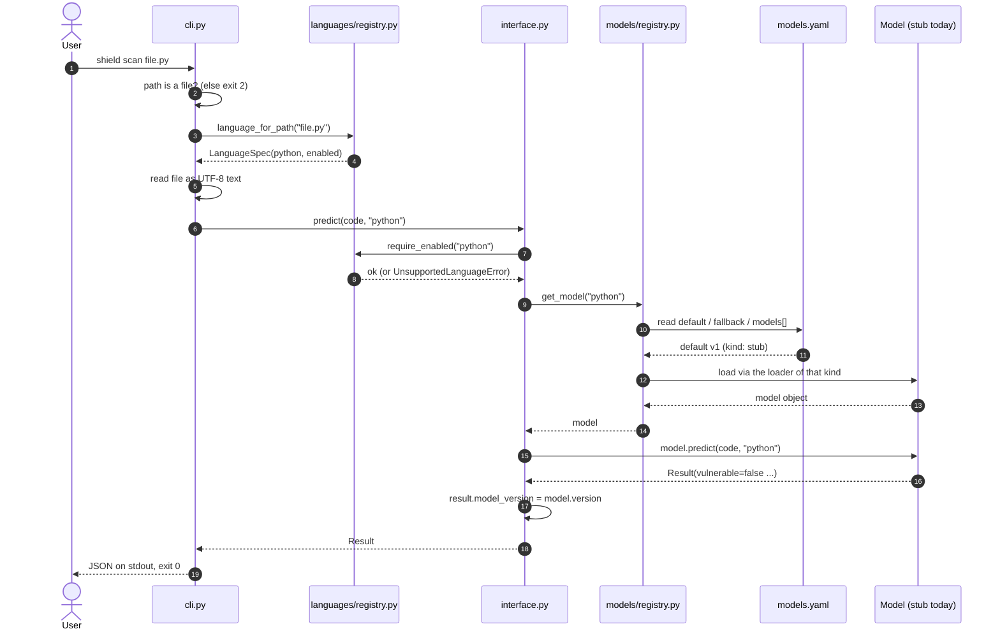

### 9.2 Story B: from raw datasets to leakage-safe splits

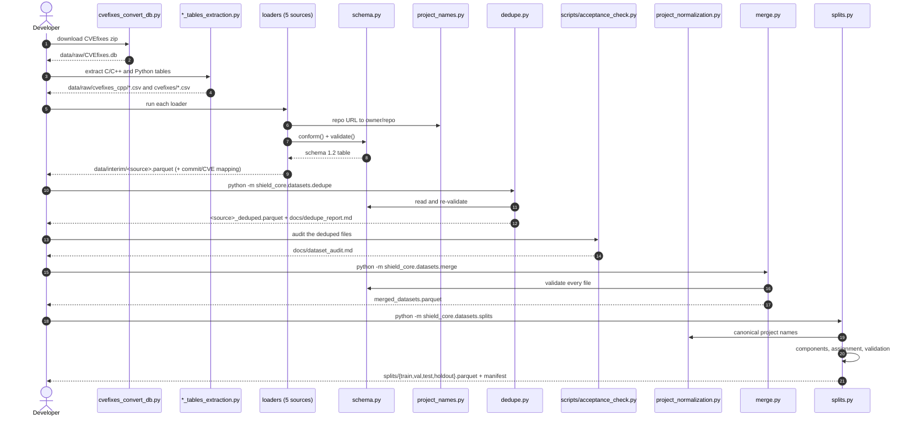

### 9.3 Story C: code → graph (with the cache in front)

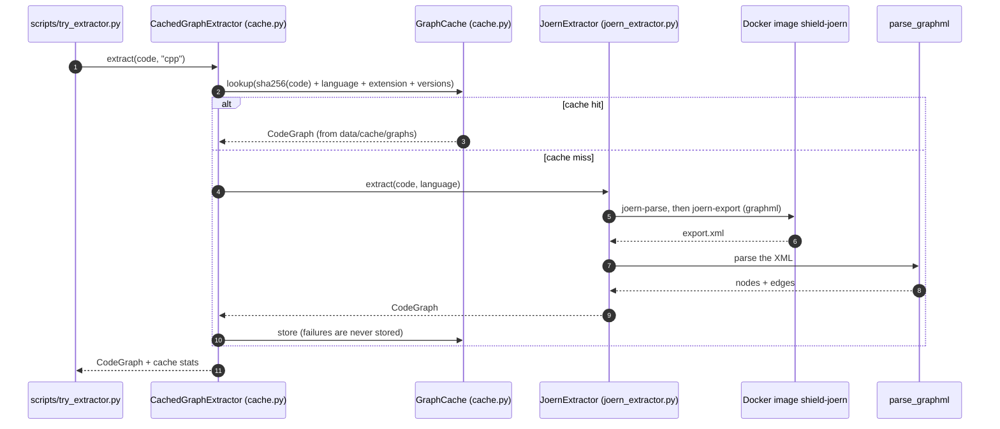

### 9.4 Story D: taint analysis (spike driver)

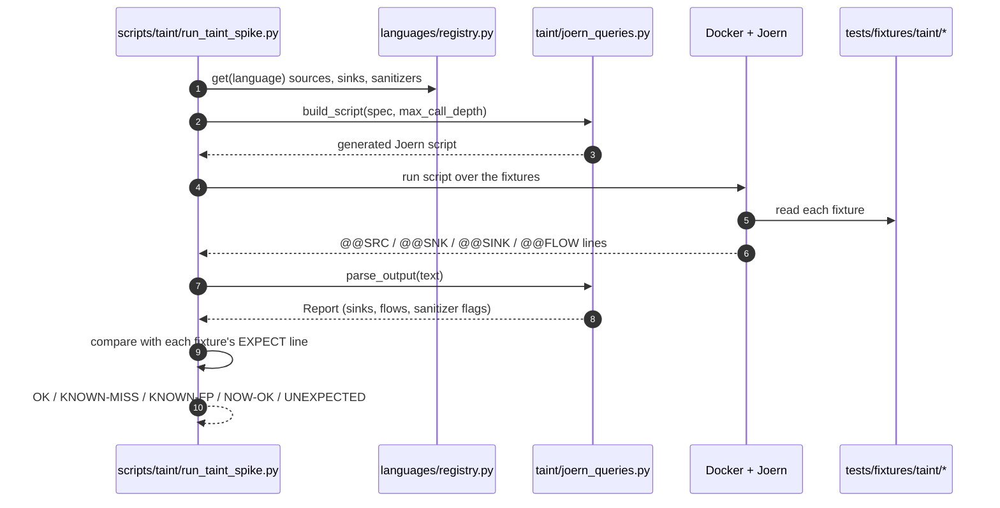

### 9.5 Story E: fix → verify (library level; **not yet reachable from the CLI**)

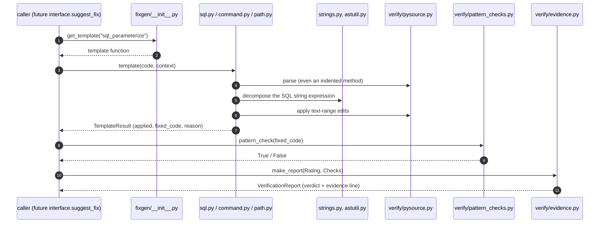

### 9.6 Who imports whom (dependency map)

An arrow `A --> B` means "A imports B". The map shows that **`languages/registry.py` is the root of
almost everything** and that `interface.py` is the only thing the outside world needs to know.

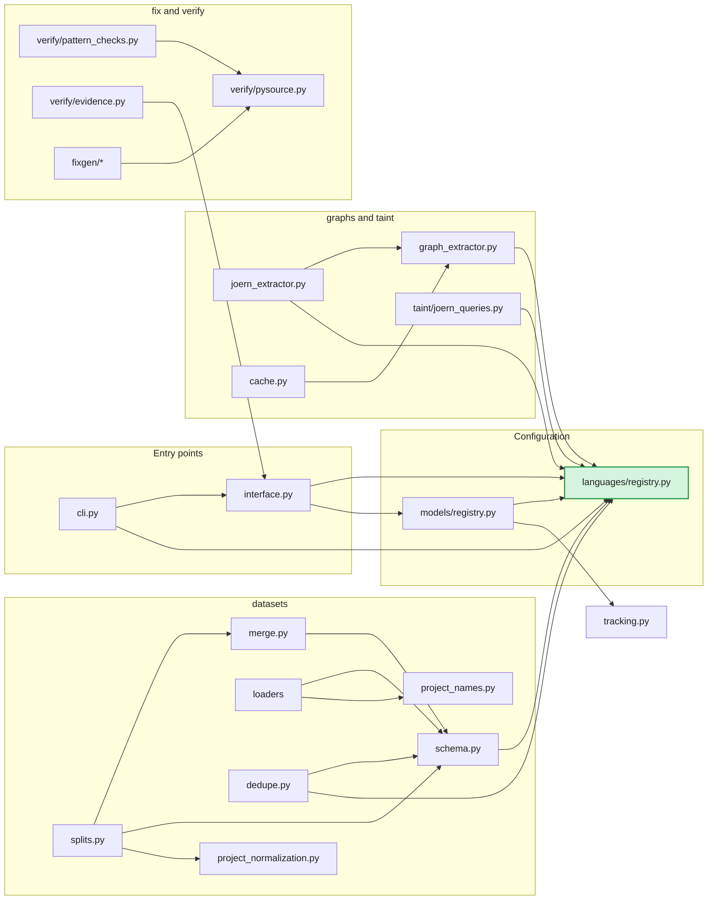

Scripts sit *outside* this map and only import from it:
`acceptance_check.py → dedupe, schema, registry` · `try_extractor.py → cache, joern_extractor` ·
`long_embedding.py → embedder` · `run_taint_spike.py → joern_queries, registry` · `demo_tracking.py → tracking`.
`train_v1.py` is deliberately standalone: it reads the split parquet files and imports nothing from `shield_core`.

---

## 10. Data flow

*Where the input starts, and how each output becomes the next input.*

### 10.1 Offline data flow: raw datasets → V1 model

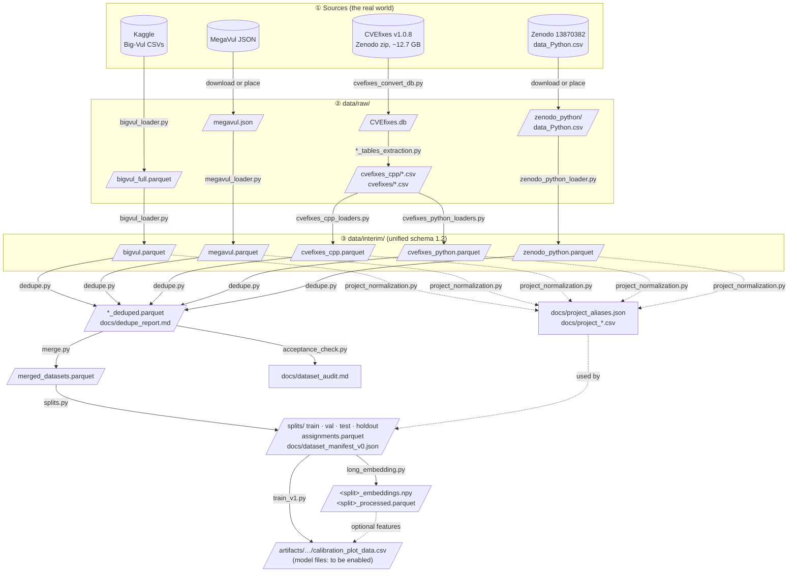

### 10.2 The chain, step by step (output of one step = input of the next)

| # | Command | Reads | Writes | Next step reads |
| :-: | --- | --- | --- | --- |
| 1 | `python -m shield_core.datasets.cvefixes_convert_db` | Zenodo zip | `data/raw/CVEfixes.db` | step 2 |
| 2 | `…c_cpp_loaders.cvefixes_cpp_tables_extraction` / `…python_loaders.cvefixes_python_tables_extraction` | `CVEfixes.db` | `data/raw/cvefixes_cpp/*.csv`, `data/raw/cvefixes/*.csv` | step 3 |
| 3 | each loader (`megavul_loader`, `bigvul_loader`, `cvefixes_*_loaders`, `zenodo_python_loader`) | raw files | `data/interim/<source>.parquet` + `<source>_commit_cve_mapping.parquet` | step 4 |
| 4 | `python -m shield_core.datasets.dedupe` | `data/interim/*.parquet` | `<source>_deduped.parquet`, `docs/dedupe_report.md` | steps 5, 6 |
| 5 | `python scripts/acceptance_check.py` | `*_deduped.parquet` | `docs/dataset_audit.md` | humans (gate decisions) |
| 5b | `python -m shield_core.datasets.project_normalization` | `*_deduped.parquet` | `docs/project_aliases.json`, `docs/project_*.csv` | step 7 (`splits.py` prints a warning if the alias file is missing) |
| 6 | `python -m shield_core.datasets.merge` | `*_deduped.parquet` | `data/interim/merged_datasets.parquet` | step 7 |
| 7 | `python -m shield_core.datasets.splits` | `merged_datasets.parquet` | `data/interim/splits/*.parquet`, `docs/dataset_manifest_v0.json` | steps 8, 9 |
| 8 | `python -m scripts.codebert_embeddings_analysis.long_embedding --data <split>.parquet` | one split | `<stem>_processed.parquet`, `<stem>_embeddings.npy` | step 9 (optional features) |
| 9 | `python scripts/train_v1.py` | `splits/{train,val,test}.parquet` (+ embeddings) | printed metrics, `artifacts/*/calibration_plot_data.csv` | *(next: register the model in `models.yaml`)* |

### 10.3 Inputs and outputs of each runtime stage

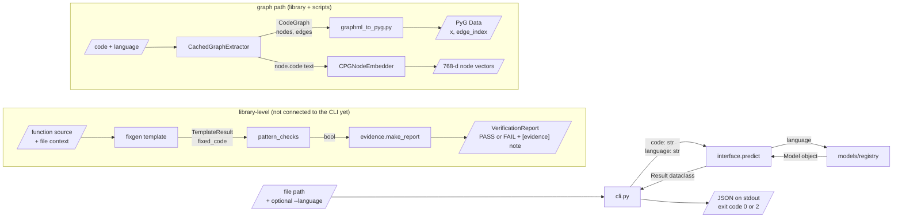

### 10.4 Artifact registry: every file that is passed between stages

| Artifact | Path | Produced by | Consumed by | Format |
| --- | --- | --- | --- | --- |
| Unified table per source | `data/interim/<source>.parquet` | loaders | `dedupe.py`, `project_normalization.py` | parquet, schema 1.2 |
| Commit↔CVE mapping | `data/interim/<source>_commit_cve_mapping.parquet` | loaders | audits, CVE recovery | parquet |
| Deduped table | `data/interim/<source>_deduped.parquet` | `dedupe.py` | `merge.py`, `acceptance_check.py`, `token_length_stats.py` | parquet |
| Merged table | `data/interim/merged_datasets.parquet` | `merge.py` | `splits.py` | parquet |
| Split files | `data/interim/splits/{train,val,test,holdout}.parquet` | `splits.py` | `long_embedding.py`, `train_v1.py` | parquet |
| Assignments | `data/interim/splits/assignments.parquet` | `splits.py` | validation, split QA (future) | parquet |
| Manifest | `docs/dataset_manifest_v0.json` | `splits.py` | reproducibility, run logging | JSON (seed, hash, counts, limitations) |
| Project aliases | `docs/project_aliases.json` | `project_normalization.py` | `normalize_project_name` (read by `splits.py`) | JSON |
| Embeddings | `<stem>_embeddings.npy` + `<stem>_processed.parquet` | `long_embedding.py` | `train_v1.py` | `float32` matrix, row *i* ↔ parquet row *i* |
| Graph cache | `data/cache/graphs/…` | `CachedGraphExtractor` | any `GraphExtractor` user | gzip JSON of `CodeGraph` |
| Joern export | `<folder>/export/export.xml` | `joern-export` | `parse_graphml`, `graphml_to_pyg.py`, `scripts/explore/*` | GraphML |
| Model config | `shield_core/models/models.yaml` | humans | `models/registry.py` | YAML |
| Language config | `languages/*.yaml` | humans | `languages/registry.py` and everything that asks it | YAML |
| Audit reports | `docs/dataset_audit.md`, `docs/dedupe_report.md`, `docs/joern_spike.md` | audit scripts | humans, gate reviews | Markdown |

---

## 11. Activity diagrams

*The whole life of the program, from the first command to the last output, showing only what is
implemented now.* Green = real and tested. Yellow = stub or partial. Dashed grey = planned next step.

### 11.1 Online lifecycle: one `shield scan` run

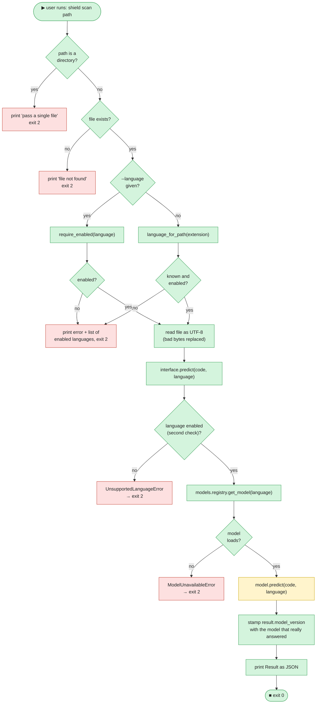

### 11.2 How the model registry chooses a model

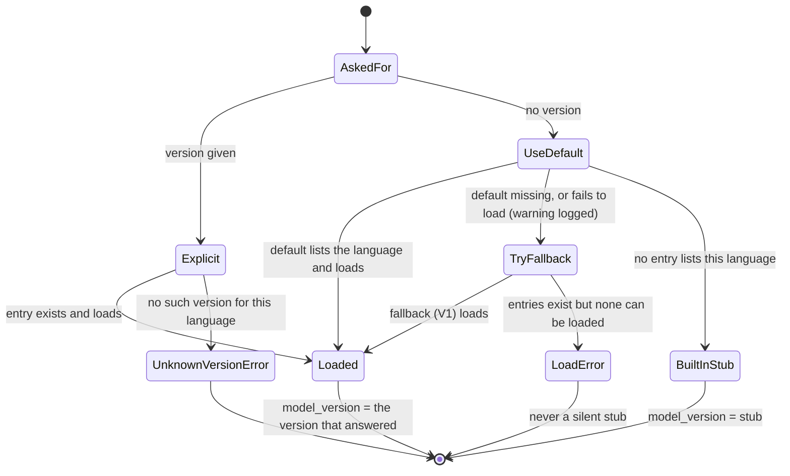

### 11.3 Offline lifecycle: from raw data to a trained V1

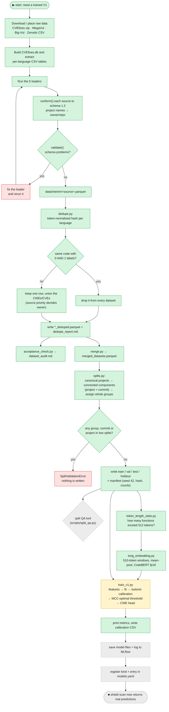

### 11.4 Lifecycle of a fix suggestion (library level today)

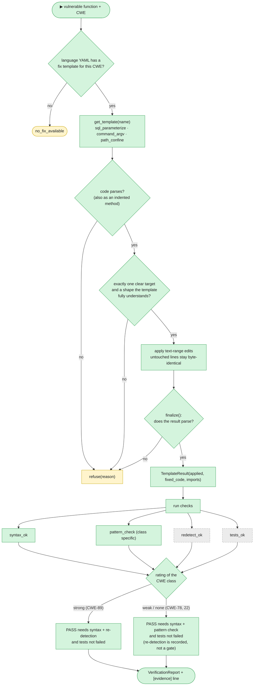

### 11.5 Lifecycle of a graph extraction

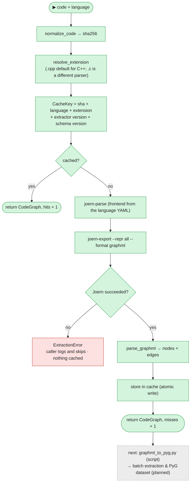

---
## 12. The public contract

`shield_core/interface.py` is the **only** surface that the CLI, the future FastAPI backend, the web app and
the VS Code extension depend on. `INTERFACE_VERSION = "1.0"` (signatures and exceptions),
`SCHEMA_VERSION = "1.0"` (payload fields). If `interface.py` and `docs/api_contract.md` ever disagree,
**`interface.py` wins**.

### 12.1 Functions

| Function | Input | Output | Today |
| --- | --- | --- | :---: |
| `predict(code, language)` | source text + a language id from the registry | `Result` | ✅ routed to the model registry (stub model) |
| `scan_repo(path)` | directory path | `RepoResult` | 🧱 empty result; raises `RepoNotFoundError` for a non-directory |
| `suggest_fix(finding, code=None)` | a `Finding` | `FixResult` | 🧱 `no_fix_available` |

### 12.2 Data classes

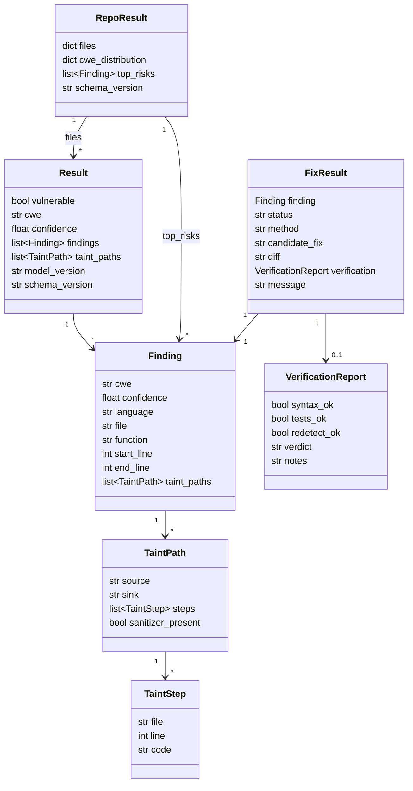

* `FixResult.status` ∈ `ok | no_fix_available | rejected | error`; `method` ∈ `template | codet5`; `verdict` ∈ `PASS | FAIL`.
* `taint_paths` on `Result` is for paths **not** tied to a single finding (normally empty); never duplicate a path already inside a finding.
* `tests_ok = None` means "no tests found, check not run" (not a failure).

### 12.3 Errors (each maps to an HTTP status for the future API)

| Exception | Raised when | HTTP | API code |
| --- | --- | :-: | --- |
| `UnsupportedLanguageError` (also a `ValueError`) | language unknown or disabled | 422 | `unsupported_language` |
| `RepoNotFoundError` (also a `FileNotFoundError`) | `scan_repo` path is not a directory | 404 | `not_found` |
| `ModelUnavailableError` (also a `RuntimeError`) | no model could be loaded, not even the V1 fallback | 503 | `model_unavailable` |

All three inherit from `ShieldError`, so callers can catch one base class.

### 12.4 The verification rule in one table (decision D35)

A fix is only called "verified" when the checks that *can* judge it all passed. Re-detection cannot tell
a correct CWE-78 / CWE-22 fix from the vulnerable code (both still "flow"), so those classes are gated by a
syntactic pattern check instead, and the evidence line says so.

| Class | Rating | `PASS` requires | Re-detection |
| --- | --- | --- | --- |
| Python CWE-89 (SQL injection) | **strong** | `syntax_ok` ∧ `redetect_ok` ∧ `tests_ok` not false | a gate |
| Python CWE-78 (command injection) | **none** | `syntax_ok` ∧ pattern check ∧ `tests_ok` not false | recorded, **not** a gate |
| Python CWE-22 (path traversal) | **none** | `syntax_ok` ∧ pattern check ∧ `tests_ok` not false | recorded, **not** a gate |

`verification.notes` always starts with an `[evidence]` line, for example:
`[evidence] syntax=ok; redetect=false(not decisive); pattern_check=ok; tests=not_run. Not verified by re-detection.`

---

## 13. Configuration files

### 13.1 `languages/<name>.yaml` (one per language)

| Key | Meaning |
| --- | --- |
| `name`, `enabled` | Language id; `false` hides it from the CLI, API and UIs. |
| `extensions` | File extensions; the **first** is the default for snippets of unknown filename (`.cpp` first, because the C++ parser accepts almost all C). |
| `joern_frontend` | Which Joern parser to use: `PYTHONSRC`, `NEWC`, `JAVASRC`. |
| `tree_sitter` | `default` grammar module and optional `by_extension` overrides (`.c` → `tree_sitter_c`). |
| `cwes` | Target CWE ids for this language (provisional lists: Python 14, C/C++ 20). |
| `sources`, `sinks`, `sanitizers` | Taint configuration as Joern regexes. A source `{kind: call\|argument\|parameter, code: …}`; a sink `{name, code?, arg\|arg_from, cwe}`; sanitizers are call-name regexes. Taint is a **feature generator**, never a verdict by itself (D29). |
| `fix_templates` | `{cwe, rating, template, pattern_check}` linking a CWE to a function in `fixgen/` and a check in `pattern_checks.py`. |

The registry **rejects** unknown keys, bad regexes and bad indices at load time, so a typo fails loudly.

### 13.2 `shield_core/models/models.yaml`

```yaml
default: v1          # used when nobody asks for a version
fallback: v1         # used when the default cannot be loaded (V1, always)
models:
  - version: v1
    kind: stub       # how to load it; the registry maps kind → loader
    languages: [python, cpp]
    # path:    file inside model_artifacts/ (or $SHIELD_MODELS_DIR)   (optional)
    # sha256:  checksum of that file; a mismatch = corrupt model       (optional)
    # options: settings passed to the loader of that kind              (optional)
```

### 13.3 Environment variables

| Variable | Used by | Effect |
| --- | --- | --- |
| `SHIELD_MODELS_CONFIG` | `models/registry.py` | Use another `models.yaml`. |
| `SHIELD_MODELS_DIR` | `models/registry.py` | Folder holding model files (default `model_artifacts/`). |
| `SHIELD_TRACKER` | `tracking.py` | `console` (default), `mlflow` or `wandb`. |
| `GITHUB_TOKEN` | `zenodo_python_loader.py --resolve-commits` | Raises the GitHub API rate limit. |

---

## 14. Datasets

All five sources are converted into **one schema** (`shield_core/datasets/schema.py`, version **1.2**):

| Column | Type | Meaning |
| --- | --- | --- |
| `code` | string | The function source. |
| `language` | string | A registry language id (`python`, `cpp`). |
| `label` | int8 | `1` vulnerable · `0` not vulnerable. |
| `cwe` | list of strings | `["CWE-119", …]` (multi-label). |
| `project` | string | `owner/repo`, or `<NA>`. |
| `commit` | string | Commit hash, or `<NA>`. |
| `date` | string | ISO `YYYY-MM-DD`, or `<NA>`. |
| `cve` | list of strings | `["CVE-2015-8467", …]`, `[]` if unknown. |
| `fixed_code` | string | Patched version when the source has it. |
| `source` | string | Dataset name. |

### 14.1 What was merged (from `docs/dedupe_report.md` and `docs/dataset_manifest_v0.json`)

| Source (`source` value) | Language | Raw rows | After dedupe | Notes |
| --- | --- | ---: | ---: | --- |
| `megavul` | C/C++ | 353,858 | 336,439 | commit-heuristic labels |
| `bigvul` | C/C++ | 188,636 | 117,910 | noisy labels; 65,511 hashes shared with MegaVul |
| `cvefixes_cpp` | C/C++ | 15,222 | 8,793 | |
| `cvefixes_python` | Python | 4,943 | 4,529 | |
| `zenodo_13870382_python` | Python | 2,316 | 644 | file name `zenodo_python`; positives only in the raw data |
| **Merged** | | | **468,315** | |

### 14.2 The split (manifest v0.2, seed 42, project-disjoint)

| Split | Rows | Share | Vulnerable | Clean | Projects | Python rows | C/C++ rows |
| --- | ---: | ---: | ---: | ---: | ---: | ---: | ---: |
| train | 339,328 | 72.5 % | 21,155 | 318,173 | 420 | 3,098 | 336,230 |
| val | 42,995 | 9.2 % | 2,701 | 40,294 | 378 | 718 | 42,277 |
| test | 42,996 | 9.2 % | 2,710 | 40,286 | 362 | 717 | 42,279 |
| holdout (project-disjoint) | 42,996 | 9.2 % | 2,711 | 40,285 | 338 | 640 | 42,356 |

> **Read this before quoting any number.** Only about **6 %** of rows are vulnerable, and **Python is only
> about 1 %** of the data (5,173 of 468,315 rows). Per-CWE results for Python rest on very few independent commit groups, so they must be
> reported *with* group counts, never as a single headline score (plan D15, D33).

### 14.3 Why splits are done this way

Random row splits leak: the same project, commit or CVE appears on both sides, and the model "remembers"
instead of generalizing. `splits.py` therefore links rows through **canonical project and commit** into
connected components and assigns **whole components** to a split, then checks that no group, commit or project
crosses a boundary. Known limitation recorded in the manifest: **364 CVE ids still cross splits**, because CVE-level
grouping is not enforced yet.

---

## 15. Testing and CI

```bash
pytest                      # all tests (≈ 376 test functions in 27 files)
pytest tests/test_splits.py # one area
ruff check .                # lint (rules E, F, I, B; line length 100)
ruff format --check .       # formatting (CI uses --check)
pre-commit run --all-files  # everything above, as on commit
```

| What is guarded | Where |
| --- | --- |
| The frozen contract (fields, versions, errors) | `test_contract.py`, `test_interface.py` |
| **No language name hard-coded outside the registry** | `test_registry.py::test_no_language_literals_outside_registry` |
| Model fallback ("remove the newer model, V1 answers") | `test_model_registry.py` |
| Graph cache: hit, miss, version bump, corruption, failure not cached | `test_graph_cache.py` |
| Taint query generation | `test_taint_queries.py` |
| Every fix template, including its refusals | `test_fix_template_*.py`, `test_pattern_checks.py`, `test_evidence.py` |
| Dataset loaders, schema, dedupe, project normalization, splits | `test_*loader*.py`, `test_schema.py`, `test_dedupe_overlap.py`, `test_project_normalizer.py`, `test_splits.py` |

**CI** (`.github/workflows/ci.yml`) runs on every pull request and every push to `main`: install (CPU torch +
`.[dev,data,ml]`) → `ruff check` → `ruff format --check` → `pytest`. `main` must always be runnable.

---

## 16. How to extend SHIELD

### 16.1 Add a language

The design goal is that this is **configuration plus data**, not core code.

1. Copy `languages/java.yaml` (or `cpp.yaml`) to `languages/<new>.yaml`; fill `extensions`, `joern_frontend`, `tree_sitter`.
2. Make sure the tree-sitter grammar is in `docker/joern/requirements-docker.txt` and the smoke test covers it.
3. Run a Joern spike on ≥ 20 samples (`scripts/joern_spike_audit/`); record the verdict in `docs/joern_spike.md`.
4. Add loaders for its datasets (`shield_core/datasets/<x>_loaders/`) that emit schema 1.2; rerun dedupe, merge, splits.
5. Set `cwes` from the audit counts; add `sources`, `sinks`, `sanitizers` backed by fixture cases in `tests/fixtures/taint/`.
6. Train per-language models with the existing scripts; add `fix_templates` for the top CWEs.
7. Set `enabled: true`. The CLI, API and UIs read the enabled list from the registry automatically.

### 16.2 Add a model kind (for example the real V1)

```yaml
# shield_core/models/models.yaml
default: v1
fallback: v1
models:
  - version: v1
    kind: tfidf_xgb                 # new kind
    languages: [python]
    path: v1/preprocessing.joblib   # relative to model_artifacts/
    sha256: <checksum>
```

```python
# shield_core/models/v1.py
def load(entry, artifact_dir):  # signature of every loader: (ModelEntry, Path) -> Model
    ...  # return an object with .version and .predict(code, language) -> Result
```

```python
# shield_core/models/registry.py  (the KINDS map)
KINDS = {"stub": _load_stub, "tfidf_xgb": "shield_core.models.v1:load"}  # a string = lazy import
# or, from your own code before the first get_model():  register_kind("tfidf_xgb", "shield_core.models.v1:load")
```

Nothing else changes: `predict()` and `shield scan` pick it up, and the registry keeps V1 as the automatic fallback.
Languages not listed in any entry keep getting the built-in stub.

### 16.3 Add a fix template

1. Write `shield_core/models/fixgen/<name>.py` with `def <name>(code: str, context: str = "") -> TemplateResult`. **Refuse when unsure** (`refuse(reason)`), and end with `finalize(...)`.
2. Register it in `TEMPLATES` in `fixgen/__init__.py`.
3. Add a structural check to `PATTERN_CHECKS` in `verify/pattern_checks.py`.
4. Declare it in the language YAML: `{cwe, rating, template, pattern_check}`; choose the rating from evidence (can re-detection tell fixed from unfixed code?).
5. Add `tests/test_fix_template_<name>.py` covering applied cases **and** refusals.

### 16.4 Add a dataset

1. Write `shield_core/datasets/<group>_loaders/<name>_loader.py` that builds a DataFrame and passes it through `schema.conform(df, source)` + `schema.validate(df)`; write `data/interim/<source>.parquet` (and a commit↔CVE mapping if available). Build `project` with `project_from_repo_url`.
2. Add the source name to `PRIORITY_ORDER` in `dedupe.py` to decide who owns duplicated code.
3. Run dedupe → project normalization → merge → splits. `merge.py` is generic and needs no edit.
4. Add a loader test and record source, version and **license** in `docs/data_sources.md` (rule D22).

---

## 17. Known gaps and sharp edges

Honest list, so nobody is surprised. Each item names the plan task that closes it.

| # | Gap | Where | Closed by |
| :-: | --- | --- | --- |
| 1 | `shield scan` always answers "not vulnerable" (stub model). | `models/models.yaml` | save V1 + register a kind (W2-P3-01, W2-P4-01) |
| 2 | `scan_repo` and `suggest_fix` are stubs; fix templates and verification are not wired into `suggest_fix`. | `interface.py` | W3-P4-02, W4-P4-02 |
| 3 | `scripts/split_qa.py` is an **empty file**; the split QA tool and its CI test do not exist yet. | `scripts/` | W2-P5-04 |
| 4 | `train_v1.py`: model saving, `joblib` dump and MLflow logging are commented out. Its `CONFIG["manifest"]` points at `data/interim/dataset_manifest_v0.json`, while `splits.py` writes `docs/dataset_manifest_v0.json`. It only matters once the logging block is enabled. | `scripts/train_v1.py` | W2-P3-01 |
| 5 | `eval/metrics.py` gives weighted aggregates only (no per-CWE / per-language / multi-label). | `eval/` | W2-P3-03 |
| 6 | No batch graph extraction yet; the converter to PyG is a script, not a library module; graph schema is `0.1-draft`. | `extraction/`, `scripts/graphml_to_pyg.py` | W2-P1-02, W2-P2-01 |
| 7 | **364 CVE ids cross splits**; CVE-level grouping is not enforced. | manifest `diagnostics` | W2-P1-03 |
| 8 | Python is only ≈ 1 % of rows; per-CWE Python claims are fragile. Class imbalance ≈ 6 % positives. | data | report group counts; D39 negatives |
| 9 | No license/source note per dataset. | `docs/` | W2-P1-04 |
| 10 | `SHIELD_PLAN.md` is linked everywhere but is not in the repo copy; `docs/long_function_strategy.md` is an empty template; `docs/pyg_setup.md` has stale lines. | repo root, `docs/` | W2-P5-05 |
| 11 | `CPGNodeEmbedder` keeps its cache in memory only. | `extraction/node_embeddings.py` | W2-P3-04 |
| 12 | C++ cross-function taint is not supported by Joern's default call resolution; claims are limited to Python and C (decision D28). | `taint/`, docs | by design |
| 13 | `sample1/ … sample5/` scratch folders at the repo root. | repo root | add to `.gitignore` or delete |

### What comes next (Gate G2 checklist, from the plan)

- [ ] `shield scan file.py` returns a **real** V1 prediction with CWE and confidence
- [ ] Per-CWE and per-language metrics on the frozen leakage-safe split, with split QA green and group counts
- [ ] Graph cache built for the training subset of Python and C/C++
- [ ] Dataset license note, label-noise hand-check, Joern graph-quality triage recorded
- [ ] CI confirmed green on `main` on GitHub

---

## 18. Keeping this README current

This README is a living map. It stays useful only if it is updated **in the same pull request** as the change.

| If your PR … | Update |
| --- | --- |
| adds, moves or deletes a file or folder | [§5](#5-folder-structure-schema), [§6](#6-folder-responsibilities), [§8](#8-file-catalog) |
| adds a capability | [§7](#7-functionality--folder-reference-table) and the status table in [§2](#2-project-status-at-a-glance) |
| changes what a file reads or writes | [§8](#8-file-catalog), [§10](#10-data-flow) (chain table + artifact registry) |
| adds an import between modules or a new call chain | [§9](#9-sequence-flow-of-the-files) (sequence or dependency map) |
| turns a stub into a real implementation | flip its badge 🧱 → 🟡 → ✅ in §2 and §7, recolour the node in [§4](#4-architecture-target-vs-what-runs-today) and [§11](#11-activity-diagrams), remove its row from [§17](#17-known-gaps-and-sharp-edges) |
| changes `interface.py` | [§12](#12-the-public-contract) **and** `docs/api_contract.md` **and** a Decisions Log row in the plan |
| adds a dataset or changes the schema | [§14](#14-datasets) |

**Colour convention in all diagrams:** green `#d4f4dd` = working · yellow `#fff4cc` = partial/stub · grey dashed `#ececec` = planned · red `#fde0e0` = error path.

---

## 19. Documentation index

`docs/` holds the written evidence behind the code. Read these when you need the *why*.

| Topic | Files |
| --- | --- |
| **Contract** | `api_contract.md` (endpoints and payloads, mirrors `interface.py`) |
| **Graphs** | `graph_schema.md` (CPG → PyG design, `0.1-draft`), `graph_extractor.md` (the extractor + cache explained from scratch), `joern_spike.md` (go/no-go per language), `pyg_setup.md` |
| **Taint** | `taint_spike.md` (what Joern follows and misses, fixture by fixture) |
| **Data audit** | `dataset_audit.md`, `dedupe_report.md`, `dataset_manifest_v0.json`, `cwe_lists_python_cpp.md`, `python_cwe_commit_audit.csv`, `cpp_cwe_commit_audit.csv` |
| **Leakage** | `python_cwe_data_leakage_high_risk.md`, `c_cpp_cwe_data_leakage_high_risk.md` |
| **Per-dataset exploration** | `bigvul_exploration.md`, `megavul_exploration.md`, `cvefixes_cpp_exploration.md`, `cvefixes_python_exploration.md`, `zenodo_python_exploration.md`, `cvefixes_*_absent_commits.md` |
| **Project names** | `project_aliases.json`, `project_alias_*.csv`, `project_name_mapping.csv`, `normalized_name_groups.csv`, `project_same_repo_other_owner.csv`, `shared_commit_projects.csv` |
| **Fixes** | `fix_template_survey.md`, `fix_templates_architecture.md`, `fix_templates_python.md` |
| **Long functions** | `long_function_policy.md` (510-token windows, mean-pool). `long_function_strategy.md` is an empty template to remove. |

---

## 20. Team workflow, Joern in Docker, troubleshooting

### 20.1 Daily workflow

Never commit directly to `main`. Every change goes through a branch and a pull request.

```bash
git checkout main
git pull
git checkout -b w2-p3-v1-training     # w<week>-p<person>-<topic>
# ... make changes, commit ...
git push -u origin w2-p3-v1-training
```

Open a pull request on GitHub: put the **task id** in the title (for example `W2-P3-01: V1 training`), wait for
CI to pass, get approval from your assigned reviewer (plan Section 5), then merge.

### 20.2 Contributing from a fork

Only if you do not have write access.

```bash
git clone https://github.com/<your-username>/NHA-5-186.git
cd NHA-5-186
git remote add upstream https://github.com/nhahub/NHA-5-186.git
git remote -v        # origin = your fork, upstream = the original

# before each new branch, sync:
git checkout main
git fetch upstream
git merge upstream/main
git push origin main
git checkout -b w2-p3-v1-training
```

Open the PR from your fork's branch into `main` of the original repo (same rules; a maintainer may need to
click "Approve and run" for a first-time contributor).

### 20.3 Project checks

| Tool | Purpose | Command |
| --- | --- | --- |
| Ruff (lint) | Finds bugs and style problems | `ruff check .` (add `--fix` to auto-fix) |
| Ruff (format) | Enforces code style | `ruff format .` (CI uses `--check`) |
| pytest | Runs tests in `tests/` | `pytest` |
| pre-commit | Runs checks automatically on each commit | `pre-commit run --all-files` |

### 20.4 Joern (Docker image)

Joern turns source code into a code property graph (syntax, control flow, data flow, call edges). It runs in
Docker so everyone uses the same pinned version (`docker/joern/Dockerfile`). The image contains Java 21, Joern
(pinned `JOERN_VERSION`), a Python venv with `tree-sitter` + Python/C/C++ grammars, a smoke test in
`/opt/smoke`, and a non-root user `shield` (mounted code appears in `/workspace`).

```bash
# build (Docker Desktop must be running), from the repo root
docker build -t shield-joern docker/joern

# check it works
docker run --rm shield-joern joern --help

# build a graph for a folder of code (writes cpg.bin into the folder)
docker run --rm -v "${PWD}/mycode:/workspace" shield-joern joern-parse .

# built-in vulnerability scan
docker run --rm -v "${PWD}/mycode:/workspace" shield-joern joern-scan .

# interactive shell
docker run --rm -it -v "${PWD}/mycode:/workspace" shield-joern

# smoke test: parses one sample per language; expect "ALL SMOKE TESTS PASSED"
docker run --rm shield-joern /opt/smoke/run_smoke.sh
```

On macOS or Linux use `$PWD` instead of `${PWD}`. To change a package version, edit
`docker/joern/requirements-docker.txt` (every line pinned `package==x.y.z`), rebuild and rerun the smoke test.
To change the Joern version, edit `JOERN_VERSION` in the Dockerfile **and** `DEFAULT_JOERN_VERSION` in
`extraction/joern_extractor.py`, rebuild and tell the team; the graph-cache key includes the Joern version, so
cached graphs are invalidated automatically.

### 20.5 Troubleshooting

| Symptom | Fix |
| --- | --- |
| Commit aborted by pre-commit | A hook reformatted files. `git add .` and commit again. |
| `ruff` or `pytest` not found | Your virtual environment is not active. |
| CI fails but passes locally | Run `ruff format --check .`; make sure you use Python 3.12 like CI. |
| Push rejected | `git pull` first; your branch is behind. |
| PowerShell blocks the activate script | `Set-ExecutionPolicy -Scope CurrentUser RemoteSigned` (once). |
| `failed to connect to the docker API` | Docker Desktop is not running. Start it and wait for "Engine running". |
| Joern build fails at the download step | Check your connection and that `JOERN_VERSION` is a real release tag. |
| Joern killed / out of memory | Raise Docker Desktop's memory limit or the `-Xmx` value in `JAVA_OPTS`. |
| `joern: command not found` | Rebuild the image and do not override the default command. |
| `invalid file request` during build | The repo is inside OneDrive and a file is an online-only placeholder. Choose "Always keep on this device" or move the repo out of OneDrive. |
| `python3: not found` during build | The first `RUN` of the Dockerfile must install `python3 python3-venv`. |
| Smoke script: "bad interpreter" | Windows line endings. The Dockerfile fixes this and `.gitattributes` keeps `*.sh` as LF. |
| Docker very slow / `500 Internal Server Error` | The C: drive is probably full. Free space, `docker builder prune`, restart Docker; aim for 20 GB free. |

---

## 21. Glossary

| Term | Meaning |
| --- | --- |
| **CWE** | Common Weakness Enumeration: the catalogue of vulnerability *types* (CWE-89 = SQL injection, CWE-78 = OS command injection, CWE-22 = path traversal, CWE-119/120/125/787 = memory-safety family). |
| **CVE** | A specific, publicly numbered vulnerability instance (`CVE-2015-8467`). |
| **CPG** | Code Property Graph: one graph merging syntax (AST), control flow (CFG), data flow (REACHING_DEF/DDG) and call edges of a program. Built by **Joern**. |
| **Joern** | Open-source code-analysis tool that produces CPGs and answers taint queries. Pinned to 4.0.647. |
| **tree-sitter** | Fast incremental parser used for function boundaries and syntax checks (Joern is too heavy for that). |
| **Taint analysis** | Tracking untrusted data from a *source* (e.g. `request.args`) to a dangerous *sink* (e.g. `execute`), noting whether a *sanitizer* sits on the path. |
| **CodeBERT** | Pretrained code language model (`microsoft/codebert-base`); frozen here, used to embed code (512-token limit → sliding windows). |
| **GNN** | Graph neural network; V3 will run one over the CPG. |
| **Fusion** | V4: combining the CodeBERT vector and the graph vector into one classifier. |
| **Leakage** | Test data that is secretly also in training data (same project, commit, CVE or code), which inflates metrics. |
| **Holdout** | A split made of whole projects never seen in train/val/test. |
| **Dedupe** | Removing identical code (after normalizing whitespace/comments) within and across datasets. |
| **Manifest** | The JSON record of how a split was made (seed, hashes, counts, limitations). |
| **Stub** | A placeholder that returns a fixed, valid answer so the rest of the pipeline can be built and tested. |
| **Gate (G1–G6)** | A go/no-go checkpoint at the end of a planning phase (see the plan). |
| **D-number** | A row in the plan's Decisions Log (for example D35 = verification verdict rule). |
| **Task id** | `W2-P3-01` = Week 2, Person 3, task 1. Used in branches, commits and PR titles. |

---

<div align="center">

*SHIELD · Semantic and Hierarchical Inference for Exploits and Logic Detection*
*Plan v1.1 · schema 1.2 · interface 1.0 · Joern 4.0.647*

</div>
