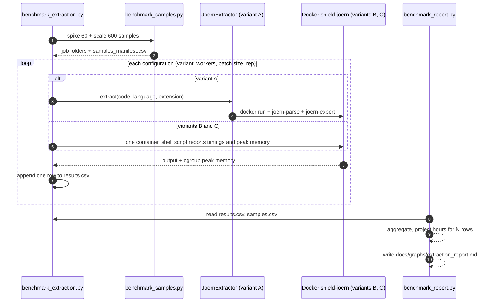

# W2-P2-05: Extraction benchmark (Joern, per-sample vs batched, 1/2/4 workers)

STATUS: DONE

> **Single source of truth for this task.** Any chat or person can continue from here.
> Repo path when committed: `docs/project/W2-P2-05_extraction_benchmark_plan.md`.
> Task id in the team plan: **W2-P2-05** (P2 = Eyad, reviewer P1 = Hatem, URGENT, planned 1.5 h, **Day 2 deadline**).
> Legend: `[ ]` todo · `[~]` in progress · `[x]` done · `[—]` dropped/moved (write why).

---

## 0. RESUME PROTOCOL (read this first if you are a new chat)

1. Read this whole file, then **Section 5 (STATE)**. It says which box was ticked last and what was in progress.
2. Verify reality before trusting the boxes (run from the repo root):
   - `git status` and `git log --oneline -15` (look for commits starting `W2-P2-05:`).
   - `ls scripts/spikes/joern/` and `ls data/interim/joern_benchmark/` (what exists on disk).
   - `pytest tests/spikes -q` (once Phase 1 exists) and `ruff check . && ruff format --check .`
   - `docker image ls shield-joern` (the Joern image must exist).
3. If the repo contradicts a ticked box, **untick it** and write one line in Section 9 (Handoff log).
4. Continue at the **first unticked box**. Do not redo ticked work.
5. **Working agreement with the user (Eyad):** implement **one step at a time**. After each *REVIEW GATE*, show the diff,
   explain it briefly, run the tests, and **wait for the user's OK** before the next step. Never hand over the whole task as a single dump.
   The user will correct imprecise explanations, so be precise.
6. After every finished step: tick its box, update Section 5 (STATE) and append one line to Section 9. This is what makes the task resumable.
7. Never leave the task "open at the end": the task is only finished when **Phase 9 is ticked and Phase 10 (professor explanation) has been delivered**.

---

## 1. What the task is, in one page

**Question to answer:** *How long does Joern graph extraction really take for N dataset rows, and which configuration
(per-sample vs batched, 1/2/4 workers) is the cheapest?*

**Why it matters:** the team plan (decision **D38**) extrapolated 5.85 s/sample × 455,236 rows ≈ **740 h** single-threaded and
therefore proposed extracting only a training subset. That 740 h is an *extrapolation from 60 samples* and the plan itself says
"the spike time may include per-run start-up". This task replaces the extrapolation with **measured** numbers so P1 can choose the
subset size and worker count (W2-P1-02 waits for this: Step 11 → Step 12 → Step 17 in the Week 2 plan).

**Deliverables (all of them are required):**

| # | Deliverable | Path |
| --- | --- | --- |
| D1 | Benchmark code (runner, pure helpers, sample builder, fidelity/attribution probe, report generator) | `scripts/spikes/joern/benchmark_*.py` |
| D2 | Unit tests (no Docker needed) + one Docker smoke test that skips when Docker/image is absent | `tests/spikes/test_benchmark_*.py` |
| D3 | Raw results (git-ignored) | `data/interim/joern_benchmark/{results.csv,samples.csv,environment.json,samples_manifest.csv}` |
| D4 | The report table answering "how long for N rows" and the worker count | `docs/graphs/extraction_report.md` (benchmark section, between markers; W2-P1-02 appends its own section later) |
| D5 | Small committed summary CSV (so the numbers survive without `data/`) | `docs/graphs/extraction_benchmark_summary.csv` |
| D6 | Updated docs: root `README.md`, `scripts/spikes/joern/README.md`, `docs/README.md`, `SHIELD_PLAN.md` (tick + numbers) | see Section 8 |
| D7 | Short message to P1 with the recommended worker count and subset sizes | Phase 5 / Phase 9 |
| D8 | Professor-style explanation of every concept and file, delivered **in the chat** at the very end | Section 10 |

**Out of scope (do NOT do in this task):** changing `shield_core/extraction/*` (contract/cache/extractor belong to the extraction
owner), building the production batch runner (that is **W2-P1-02**, P1), choosing the D38 subset (P1 decides; P2 supplies numbers),
CPG→PyG, taint. If a finding suggests a library change (for example an `extract_many` method), **write it in the report as a recommendation**.

---

## 2. Facts verified in the repo (so nobody re-discovers them)

| Fact | Where | Why it matters |
| --- | --- | --- |
| The spike ran **one `docker run` per sample** and inside it **three** Joern commands: `joern-parse`, `joern-export --repr cfg --format dot`, `joern-export --repr ddg --format dot`. | `scripts/spikes/joern/run_joern_spike.py` | The 5.85 s figure includes Docker start-up **and three JVM launches**. |
| The production extractor runs **two** commands per sample: `joern-parse` then `joern-export cpg.bin --repr all --format graphml`, then parses the XML in Python. | `shield_core/extraction/joern_extractor.py` | The benchmark must time the **production path**, not the spike path. Variant A uses `JoernExtractor` itself. |
| The spike measured memory by polling `docker stats --no-stream` every 0.25 s; that command itself takes about a second, so short runs are sampled very coarsely. | `run_joern_spike.py` | Peak memory may be under-reported. The benchmark reads the container's cgroup peak counter instead (Section 3.4). |
| `JoernExtractor.extract()` creates a temp dir, `chmod 0o777`, writes `code<ext>` with normalized newlines, runs Docker (`-v <tmp>:/workspace/sample`), reads `export/export.xml`, and returns a `CodeGraph`. Default timeout 300 s. Failures raise `ExtractionError` and are never cached. | `joern_extractor.py`, `cache.py` | Variant A = call this code. For C use `extension=".c"` with language `cpp`. |
| Joern in the image has `JAVA_OPTS=-Xmx4G` by default. Four parallel containers can therefore ask for 16 GB. | `docker/joern/Dockerfile` | Workers × Xmx must fit in Docker Desktop's memory limit. |
| Parsing a **directory** with several files produces **one** `cpg.bin` and **one** `export.xml` (the folder `sample1/` in the repo has two `.py` files and one export). | `sample1/`, README §20.4 | Batching is possible, but the combined graph must be split per file afterwards. |
| In the exported GraphML, `METHOD` nodes carry `FILENAME` for C (`overflow.c` in `sample4`), but for the Python samples inspected (`sample1`, `sample3`) `FILENAME` is `<empty>` and the `FILE` nodes have empty/`N/A` names. | `sample1/export/export.xml`, `sample4/export/export.xml` | **Risk R1:** splitting a batched Python export per file is not guaranteed. Phase 7 investigates this before any batching claim for Python. |
| Row counts disagree between documents: plan says 455,236 deduped rows and 29,855 vulnerable; README §14 says 468,315 merged rows. | `SHIELD_PLAN.md` D38, `README.md` §14 | Projections must read the **real files** at run time and print which counts they used. |
| Python is about 5,173 rows in total (README §14), so extracting **all** Python rows is cheap; the cost is C/C++. | `README.md` §14 | Report Python and C/C++ separately. |
| CI runs `ruff check`, `ruff format --check`, `pytest` (Python 3.12, no Docker, no GPU). `tests/test_layout.py` requires: every code folder has `__init__.py` + `README.md`; every path written in backticks in the root README that starts with `docs/`, `scripts/`, `shield_core/`, `tests/`, `docker/` must **exist**. | `.github/workflows/ci.yml`, `tests/test_layout.py` | Tests must not need Docker. Write README paths only for files that really exist. |
| Line length 100, ruff rules E, F, I, B. Paths come from `shield_core/paths.py`. | `pyproject.toml`, `paths.py` | Add path constants there instead of `parents[N]`. |
| `SHIELD_PLAN.md` uses Windows line endings (CRLF). | file | When editing it, keep CRLF (do not convert the whole file). |

---

## 3. Method

### 3.1 The cost model (the idea the whole benchmark rests on)

Time for one sample is modelled as **t = F + v·s**:
- **F** = fixed cost paid per call regardless of size: `docker run` start-up, JVM start-up of `joern-parse`, JVM start-up of `joern-export`, temp-file I/O.
- **v·s** = variable cost that grows with the size *s* of the function (parsing, dataflow, export, XML parsing).

If **F** dominates, running many functions per Joern call (batching) cuts the per-sample time to roughly **F/N + v·s**.
The benchmark's job is to **measure F and v**, then check how much batching, and parallel workers, really help.

### 3.2 Variants

| Variant | What runs | Docker runs | JVM launches (parse+export) | Purpose |
| --- | --- | --- | --- | --- |
| **A** per-sample (production) | `JoernExtractor(docker_image="shield-joern").extract(code, lang, ext)` for each sample | 1 per sample | 2 per sample | The real baseline; includes tempdir + XML parse |
| **B** one container, many samples sequentially | One `docker run`, a shell loop inside, per sample: `joern-parse` then `joern-export` | 1 per worker | 2 per sample | Isolates the Docker start-up cost (A − B) and gives the phase split (parse vs export) |
| **C** batched | One `docker run`; put N files in one folder; **one** `joern-parse <folder>` and **one** `joern-export` for the batch | 1 per batch | 2 per batch | Amortizes JVM start-up. Needs per-file attribution of the combined graph (Phase 7) |
| **D** (optional, time-box 30 min) | One JVM, Joern script with a loop of `importCode` | 1 | 1 per worker | Only if the Joern scripting API for exporting is clear. If not, record "not evaluated" and list it as future work |

Batch sizes for C: **N ∈ {1, 10, 20, 50}** (N = 1 is C degenerate = B with one file, a consistency check).
Workers: **1, 2, 4** (the machine has 24 logical CPUs, so add **8** as an optional extra if the memory peak per worker allows it) (separate containers running in parallel; for A, 1/2/4 threads each calling the extractor).
`-Xmx` per worker: `4g` default; if 4 workers do not fit in RAM, rerun with `2g` and record it.

### 3.3 Experiments

| ID | Name | Data | Config | Output |
| --- | --- | --- | --- | --- |
| E0 | Environment capture | – | – | CPU count, RAM, Docker CPUs/RAM limit, OS, image id, Joern version, power mode |
| E1 | Baseline reproduction | spike 60 (20 python, 20 c, 20 cpp) | A, workers 1 | Compare with the old 5.85 s; explains the gap between the spike path and the production path |
| E2 | Fixed-cost decomposition | 5 small + 5 large functions per language | `docker run --rm shield-joern true`; B with one file (phase markers) | Docker overhead, parse time, export time, XML parse time |
| E3 | Variants at 1 worker | spike 60 | A, B, C(N=10,20,50), 3 repetitions | Per-sample time per variant, speed-up vs A |
| E4 | Workers | spike 60 | A and best of B/C at workers 1, 2, 4, 2 repetitions | Wall time, throughput, speed-up, parallel efficiency, peak memory |
| E5 | Scale-up | 200 **new** samples per language (600 total), seed 43, disjoint from the spike 60 | A (workers 4) and best config (workers 4), 1 repetition | Heavy-tail behaviour (p95, max, timeouts); checks that 60 samples were not lucky |
| E6 | Size sensitivity | all measured samples | uses per-sample data from E1/E5 | Time vs characters/lines; correlation; which share of time is the long tail |
| E7 | Fidelity of batching | spike 60 | C vs A, per file | Do node/edge-type histograms match? How many cross-file CALL edges appear? Which attribution signal works for Python? |
| E8 | Projections | real parquet counts | measured throughput | "Hours for N rows" and "rows per 10-hour night" for the D38 subset scenarios |

### 3.4 Measurement rules (fair benchmarking)

1. **Wall-clock of the whole run**, not the sum of per-sample times. With parallel workers the sum is larger than reality.
   Use `time.perf_counter()`. Per-sample numbers exist for variant A and from markers inside the container for B/C.
2. **Warm-up:** run one throw-away sample per variant first (the first Docker run pulls caches). Record it as `rep = 0` and exclude it from statistics.
3. **Repetitions:** 3 for the spike 60 at one worker, 2 for worker experiments, 1 for the scale set. Report **median** and min–max, never only the mean.
4. **Randomize run order** of variants (fixed seed) so that thermal throttling or background load does not always hit the same variant.
5. **Control the machine:** laptop plugged in, high-performance power mode, other heavy apps closed, same Docker Desktop limits for all runs. Write what you did in `environment.json` notes.
6. **Peak memory** = the container's cgroup counter read at the end of the in-container script:
   `cat /sys/fs/cgroup/memory.peak` (cgroup v2) with fallback `/sys/fs/cgroup/memory/memory.max_usage_in_bytes` (v1). If neither exists, fall back to polling `docker stats` and mark `peak_method = docker_stats`.
   (UNVERIFIED on this machine: check in Phase 3, step "probe cgroup".)
7. **Failures are data.** Classify each failure (`timeout`, `oom`, `joern_error`, `no_export`, `xml_error`, `docker_error`). Never drop failed samples from counts; report success rate next to every time.
8. **No cache** in this benchmark (do not wrap the extractor in `CachedGraphExtractor`); otherwise repeated runs measure the cache.
9. **Cleanup:** containers are named `shield-bench-*`; always `docker rm -f` in a `finally`. Work dirs live under `data/interim/joern_benchmark/work/` and are deleted after each run unless `--keep`.
10. **Hypotheses are not results.** H1 fixed costs dominate · H2 batching of 20–50 gives a large per-sample speed-up · H3 workers scale sub-linearly (cores, RAM) · H4 Python batching has an attribution problem. State in the report whether each was confirmed, rejected or untested. **Do not tune the experiment to confirm them.**

### 3.5 Projection formula (E8)

`hours(N) = N / throughput / 3600`, where `throughput = samples / wall_seconds` of the chosen configuration on the **scale set**
(use the median across repetitions; also print a pessimistic figure using the p95 per-sample time).
`rows_per_night = throughput × 36000` (10 h). Check the arithmetic against the old figure: 5.85 s × 455,236 / 3600 = 739.8 h.
Subset scenarios (counts must be read from the real parquet files; use plan numbers only as a labelled fallback):

| Scenario | Definition |
| --- | --- |
| S1 | all deduped rows (the 740 h case) |
| S2 | all vulnerable rows in scope CWEs |
| S3 | S2 + clean rows sampled 1:1 |
| S4 | S2 + clean rows sampled 3:1 |
| S5 | all Python rows (about 5k) |

Each scenario is reported separately for Python and C/C++, for the best config and for A (the baseline).

---

## 4. Files to create or change

```
scripts/spikes/joern/
  benchmark_core.py          # PURE helpers (no Docker): dataclasses, batching, marker parsing, failure classes, stats, projections, CSV I/O
  benchmark_samples.py       # builds the spike-60 and scale-600 sample sets + samples_manifest.csv
  benchmark_extraction.py    # CLI + Docker runners for variants A, B, C, workers, resume, dry-run, environment capture
  benchmark_fidelity.py      # E7: attribution of nodes to files in a batched export; compare with per-file graphs
  benchmark_report.py        # results.csv -> docs/graphs/extraction_report.md (between markers) + summary csv + projections
  README.md                  # (edit) add the 5 files
tests/spikes/
  test_benchmark_core.py
  test_benchmark_samples.py
  test_benchmark_commands.py     # command/script builders (pure)
  test_benchmark_report.py
  test_benchmark_fidelity.py
  test_benchmark_docker_smoke.py # skipped without Docker + image
shield_core/paths.py         # (edit) BENCHMARK_DIR = INTERIM_DIR / "joern_benchmark"
docs/graphs/extraction_report.md
docs/graphs/extraction_benchmark_summary.csv
docs/project/W2-P2-05_extraction_benchmark_plan.md   # this file
README.md, docs/README.md, SHIELD_PLAN.md            # (edit) Section 8
```

Language literals (`"python"`, `"c"`, `"cpp"`) may appear in `scripts/` (the spike already does this) but **not** in `shield_core/`
(a test enforces it). Run `pytest tests/languages/test_registry.py` after editing `paths.py`.

Branch: `w2-p2-extraction-benchmark`. Commits and PR title start with `W2-P2-05:`. No reviewers requested, per user's instruction.

---

## 5. STATE (update after every step)

```
current_phase:      Phase 10 professor explanation and practice
last_ticked_step:   10.1
in_progress:        10.2; exercises provided, continue with the user's attempts and questions
branch:             w2-p2-extraction-benchmark
machine:            Windows, 24 logical CPUs, 16 GB RAM (16,907,100,160 B); Docker Desktop (WSL2, no .wslconfig = defaults) sees 24 CPUs and 8,188,317,696 B (~7.6 GiB)
repo location:      C:\Users\eyada\OneDrive\Desktop\SHIELD  <-- INSIDE OneDrive (see R9: benchmark work dirs must be outside it)
baseline:           ruff clean, 184 files formatted, pytest 697 passed + 1 skipped (151 s); after Phase 1: tests/spikes = 52 passed; after 2.2: 67 passed; after 3.2: 97 passed; after 3.3: 105 passed + 1 skipped on Eyad's Windows; after 3.4 code: 127 passed here; after 3.5: tests/spikes 139 passed + 1 skipped on Eyad's Windows; after 3.6: 148 passed + 1 skipped; after 3.7: 170 passed + 1 skipped; after 3.8/3.9 on Eyad's Windows: tests/spikes 171 (smoke test PASSED against real Docker, 10.4 s), whole suite 803 passed + 2 skipped (194 s), ruff check clean, ruff format reformatted 3 files (the repo copy is now the source of truth); Phase 5 report tests/spikes 113 passed + 2 skipped; after Phase 7 tests/spikes 118 passed + 2 skipped
docker image:       shield-joern:latest, id 51394b312f9a, 8.49 GB disk
probes:             cgroup v2 works (/sys/fs/cgroup/memory.peak) -> peak_method = cgroup_v2; JAVA_OPTS reaches the container env (-Xmx512m printed);
                    Joern's own banner says the frontend (pysrc2cpg / c2cpg) runs as a SEPARATE process with -J-Xmx4096m -> JAVA_OPTS may NOT cap it (to verify in Phase 5)
docker floor:       `docker run --rm shield-joern true` = 0.762, 0.792, 0.740, 0.728, 0.796 s (median 0.762 s)
data present:       *_samples_20 for bigvul, megavul, cvefixes_python (+cvefixes_cpp); *_deduped for bigvul, megavul, cvefixes_python, cvefixes_cpp
key numbers so far: Docker start-up is only ~0.76 s of the old 5.85 s/sample -> most of F must be the JVM launches and Joern work (H1 needs refining)
samples (2.3):      manifest = 660 rows (60 spike + 600 scale); function length in lines, min / median / p95 / max
                    spike : python 2/20/115/243 · c 1/17/106/245 · cpp 3/10/75/82   (n=20 each)
                    scale : python 2/21/110/6527 · c 1/11/107/828 · cpp 1/19/90/609 (n=200 each)
                    note: python scale max 6527 lines -> likely timeout/heavy-tail case for E5/E6 (300 s default timeout)
environment.json:   captured 2026-10-26 23:56 UTC (24 cpu, 16,907,100,160 B RAM, Docker 24 cpu / 8,188,325,888 B, image 51394b312f9a..., repo_inside_onedrive=true); Legion Performance Mode verified; plug-in and background-app state not independently verified
step 3.4 smoke:     floor = 10.790 (cold), 0.670, 0.672, 0.671, 0.644 s (median 0.671 s);
                    python_spike_001 (5 lines, rep=1): wall=8.975 s, parse=5.978 s, export=2.276 s, xml=0.002 s, peak=249.0 MiB, nodes=21, edges=52
step 3.5 hand run:  `--phase variants --variant A --limit 1 --reps 1 --no-warmup` (no warm-up, so the first run is cold):
                    c_spike_001 23.514 s (18n/42e) · python_spike_001 8.89 s (21n/52e) · cpp_spike_001 10.288 s (120n/579e); all ok
                    python A 8.89 s vs python B 8.975 s (3.4): same within noise; C's 23.5 s is probably the cold first run (random order), to be confirmed with a warm-up in Phase 5
step 3.6 hand run:  `--variant C --batch-sizes 5 --limit 5 --reps 1 --no-warmup --keep` (first 5 samples per group, ONE batch each, cold, no warm-up); all ok:
                    c      5/5 wall=23.09 s (4.618 s/sample) peak=457.2 MiB batch graph 591n/3678e
                    python 5/5 wall=13.437 s (2.687 s/sample) peak=293.8 MiB batch graph 1144n/7828e
                    cpp    5/5 wall=10.96 s (2.192 s/sample) peak=267.9 MiB batch graph 388n/2277e
                    NOT yet comparable with A/B (different samples, no warm-up): C's c run is probably the cold first run again; Phase 5 decides
step 3.7 hand run:  `--phase all --dry-run` = 131 runs, rough 3.1 h (guesses, not measured; the plan said ~2 h machine time -> check after Phase 5).
                    `--phase workers --workers 1,2 --limit 4 --reps 1 --no-warmup` (default best = C b=20, no E3 yet), all ok 4/4, --resume skipped all 12, no shield-bench containers left:
                    A  s/sample w1->w2: python 8.895->5.422 (speed-up 1.64) · c 7.399->4.056 (1.82) · cpp 8.468->4.663 (1.82)
                    C  wall w1 / w2: python 11.66/11.45 · c 7.94/8.88 · cpp 20.13/10.18 (cpp w1 was the cold first run); n=4 is too small for C shards (2 JVM starts for 2 samples each), E4 uses 20
                    peak per C container 259-270 MiB at both worker counts

Phase 5 minimum-run numbers (current report: `docs/graphs/extraction_report.md`):
                    E2 on Legion Performance Mode: Docker floor median 0.785 s; parse/export/XML medians B — c 2.732/1.123/0.001 s, cpp 3.018/1.446/0.005 s, Python 2.853/1.773/0.014 s; all E2 samples succeeded. Earlier E2 Quiet Mode rows are retained as experiment E2_QUIET and excluded from the report tables.
                    E3 production A median s/sample — c 4.847, cpp 5.049, Python 5.451; B — c 4.454, cpp 4.472, Python 4.901; best fully successful C — c b20 0.486, cpp b20 0.426, Python b50 0.645. C/c/b50 had one Docker error (20/20 failed at rep 2); two other reps succeeded, so the report shows 66.7% success and does not recommend it for c.
                    E4 A workers 1/2/4: c 102.197/56.597/40.904 s, cpp 98.668/56.945/39.433 s, Python 104.315/57.448/39.928 s; 4-worker speed-up 2.50x/2.50x/2.61x, no failures. C b20 at 2 workers: c/cpp/Python throughput 2.420/2.534/1.992 samples/s, peak 290.7/295.4/504.5 MiB; 4 workers gave no consistent throughput gain; no OOM.
                    E5 scale A at 4 workers: C/C++/Python = 0.606/0.558/0.503 samples/s; all 600 samples succeeded (200 per group, six configurations). Fastest successful non-batched E3 B at one worker = 0.225/0.224/0.204 samples/s.
                    E5 C/b20 memory peaks: C/C++/Python = 851.3/824.5/1871.1 MiB. Batched two-file fidelity failed the exact per-file node/edge type histogram rule for every group, so scale projections use A.
                    Final S1 projections from E5 A: C 48.58 h, C++ 167.60 h, Python 2.48 h. D38 remains proposed for P1 decision; no decision was made in this benchmark.
                    A c-group w1 = 7.4 s/sample warm vs 23.5 s in 3.5: confirms the 23.5 s was a cold start
                    Phase 7 hint (C group, 3 identical tiny functions of 18n/42e): batch graphs fit  total = shared overhead + per-file part  exactly
                    (1 file 18n/42e, 2 files 25n/64e, 4 files 39n/108e -> 11n/20e shared + 7n/22e per file). Only these near-identical samples; not yet a fidelity claim
open questions:     B's wall_seconds = docker run only (no file writing, no host XML parse); A includes its tempdir + XML parse, so the report must add xml_parse_seconds to B before comparing with A
open questions (old): none
blockers:           none; PR #51 is open at https://github.com/nhahub/NHA-5-186/pull/51; CI lint-and-test passed on bc567c8; no reviewers requested per user
```

---

## 6. PHASES AND CHECKLISTS

Time estimates are honest ones: the team plan says 1.5 h, but a measured, reproducible, documented benchmark is closer to **5 to 7 hours of work plus about 2 hours of unattended machine time**. Phase 5 is the **minimum useful result for P1 (Day 2)**; Phases 6 to 8 refine it. If time is short, finish Phase 5, send the numbers to P1, and tell the team that the remaining hours come out of P2's flexible tasks (W2-P2-03/-02).

### Phase 0: Setup and sanity (≈ 30 min)

- [x] 0.1 `git checkout main && git pull && git checkout -b w2-p2-extraction-benchmark`
- [x] 0.2 Environment works: `pip install -e ".[dev,data,ml]"`, `ruff check .`, `ruff format --check .`, `pytest -q` all green **before** any change (record the number of tests).
- [x] 0.3 Docker is running and the image exists: `docker image ls shield-joern`. If missing: `docker build -t shield-joern docker/joern` then `docker run --rm shield-joern /opt/smoke/run_smoke.sh` must end with `ALL SMOKE TESTS PASSED`.
- [x] 0.4 Data exists: `data/interim/{cvefixes_python,bigvul,megavul}_samples_20.parquet` (the spike samples) and `data/interim/{cvefixes_python,bigvul,megavul}_deduped.parquet`. If a file is missing, regenerate with the commands in README §3 ("rebuild the dataset") and the sample scripts in `shield_core/datasets/samples/`; write what you did in Section 9.
- [x] 0.5 Docker Desktop limits noted (Settings → Resources, or `docker info --format "{{.NCPU}} CPUs {{.MemTotal}} bytes"`). On Windows/WSL2 the limit lives in `%UserProfile%\.wslconfig` (`memory=`, `processors=`). Write the values into STATE.
- [x] 0.6 Probe cgroup memory counter: `docker run --rm shield-joern bash -c "cat /sys/fs/cgroup/memory.peak || cat /sys/fs/cgroup/memory/memory.max_usage_in_bytes"`. Record which works (decides `peak_method`).
- [x] 0.7 Probe that `JAVA_OPTS` is honoured: `docker run --rm -e JAVA_OPTS=-Xmx512m shield-joern bash -c "echo \$JAVA_OPTS && joern-parse --help | head -3"`. Record result.
- [x] 0.8 Probe the Docker cost floor: time `docker run --rm shield-joern true` five times (record each).
- [x] 0.9 Commit this plan file into `docs/project/` (first commit: `W2-P2-05: add benchmark plan`).
- **REVIEW GATE 0:** show the user the outputs of 0.3 to 0.8. Wait for OK.

### Phase 1: Pure core module and its tests (≈ 60 min)

Create `scripts/spikes/joern/benchmark_core.py` (**no** Docker, no pandas required for the helpers) and `tests/spikes/test_benchmark_core.py`.
Also add `BENCHMARK_DIR` to `shield_core/paths.py`.

Required API (names fixed so later phases and other chats agree):

```python
BENCH_GROUPS: dict[str, tuple[str, str]]
    # {"python": ("python", ".py"), "c": ("cpp", ".c"), "cpp": ("cpp", ".cpp")}
    # group -> (registry language id, file extension)

@dataclass(frozen=True)
class Sample:  sample_id: str; group: str; extension: str; code: str; set_name: str  # "spike" | "scale"
               source: str; row_index: int
    n_chars, n_lines (properties), sha256 (of normalized code)

FAILURE_CLASSES = ("ok","timeout","oom","joern_error","no_export","xml_error","docker_error")

def split_batches(items: Sequence[T], size: int) -> list[list[T]]        # ValueError if size < 1
def parse_markers(stdout: str) -> Markers                                  # lines "@@T name seconds" and "@@PEAK bytes|NA"
def classify_failure(returncode: int | None, timed_out: bool, stderr: str, export_exists: bool) -> str
def summarize(values: Sequence[float]) -> dict                             # n, mean, median, p95 (nearest-rank), min, max; empty -> n=0 and None
def project_hours(n_rows: int, samples_per_second: float) -> float         # ValueError if throughput <= 0
def rows_per_night(samples_per_second: float, hours: float = 10.0) -> int
def config_key(variant, group, set_name, workers, batch_size, xmx, rep) -> tuple
RESULT_COLUMNS: list[str]; SAMPLE_COLUMNS: list[str]
def append_row(path, columns, row: dict) -> None      # creates file with header; append-only; flushes
def read_rows(path) -> list[dict]
def completed_keys(rows) -> set[tuple]                # for --resume
```

`RESULT_COLUMNS` (one row per measured run):
`run_id, timestamp_utc, experiment, variant, group, extension, set_name, n_samples, batch_size, workers, xmx, rep, wall_seconds, seconds_per_sample, samples_per_second, ok_count, fail_count, fail_reasons_json, peak_mib, peak_method, parse_seconds, export_seconds, xml_parse_seconds, notes`.
`SAMPLE_COLUMNS` (one row per sample per run, when measurable): `run_id, sample_id, group, n_chars, n_lines, seconds, ok, failure_class, nodes, edges`.

Checklist:

- [x] 1.1 `paths.py`: add `BENCHMARK_DIR`; `pytest tests/languages/test_registry.py tests/test_layout.py -q` still green.
- [x] 1.2 Write the tests **first** (they define behaviour): batching (exact division, remainder, size larger than list, empty list, size 0 raises) · marker parsing (normal, noise lines ignored, `@@PEAK NA`, missing markers) · failure classes (timeout, return code 137 → `oom`, non-zero → `joern_error`, rc 0 but no export → `no_export`, docker "Cannot connect" in stderr → `docker_error`) · `summarize` (odd/even length median, p95 nearest-rank on 20 values, empty, single value) · projections (5.85 s/sample ↔ throughput 1/5.85 → 739.8 h for 455,236 rows within 0.1; zero throughput raises; `rows_per_night(1.0) == 36000`) · CSV (header written once, append keeps order, roundtrip, unknown column raises) · `completed_keys`.
- [x] 1.3 Implement until green. Keep functions small and typed.
- [x] 1.4 `ruff check . && ruff format .` then `pytest tests/spikes -q`.
- [x] 1.5 Commit: `W2-P2-05: benchmark core helpers and tests`.
- **REVIEW GATE 1:** walk the user through each function and test; wait for OK.

### Phase 2: Sample sets (≈ 45 min)

Create `scripts/spikes/joern/benchmark_samples.py` + `tests/spikes/test_benchmark_samples.py`.

Rules:
- **spike set** = the 60 rows from the three `*_samples_20.parquet` files, in the same order as the spike (python ← cvefixes_python, c ← bigvul, cpp ← megavul), so E1 is comparable.
- **scale set** = 200 rows per group drawn with `random_state=43` from `data/interim/{cvefixes_python,bigvul,megavul}_deduped.parquet`, **excluding** any row whose `sha256` is in the spike set, dropping empty/non-string code. Do not truncate or filter by length (the natural distribution is the point); the manifest records `n_chars`, `n_lines`.
- `sample_id` = `<group>_<set>_<NNN>` (ASCII only, safe as a file name).
- Write code files with `newline="\n"` after `normalize_code` (otherwise Windows turns `\n` into `\r\n` and the hash and the parse change).
- Output `data/interim/joern_benchmark/samples_manifest.csv`: `sample_id, group, set_name, extension, source, row_index, sha256, n_chars, n_lines`.

Checklist:

- [x] 2.1 Tests first: draw is deterministic (same seed → same ids); scale excludes spike hashes; 200 per group when enough rows else min with a warning; empty code dropped; ids unique and filename-safe; written files contain no `\r`; works on tiny synthetic DataFrames (no real data in CI).
- [x] 2.2 Implement `load_spike_samples(dir)`, `draw_scale_samples(n_per_group, seed, exclude_sha, dir)`, `write_job_dir(job_dir, samples)`, `write_manifest(path, samples)`.
- [x] 2.3 Run once on the real data; print counts per group and the min/median/p95/max of `n_lines` per group. Paste them into STATE (they feed the report).
- [x] 2.4 Commit: `W2-P2-05: benchmark sample sets`.
- **REVIEW GATE 2.**

### Phase 3: Runner (≈ 120 min, the biggest phase)

Create `scripts/spikes/joern/benchmark_extraction.py` and `tests/spikes/test_benchmark_commands.py`, `tests/spikes/test_benchmark_docker_smoke.py`.
Split **pure builders** (tested) from **executors** (need Docker).

Pure builders (tested without Docker):

```python
def build_batch_script(variant: str, files: list[str], frontend: str, batch_size: int) -> str
    # bash script run inside the container, cwd = /workspace/job
    # variant "B": for each file f:  t0=$(date +%s.%N); joern-parse f --language <frontend> -o cpg_<k>.bin;
    #              t1=...; joern-export cpg_<k>.bin --repr all --format graphml --out export_<k>; t2=...;  echo "@@T parse_<k> ..." "@@T export_<k> ..."
    # variant "C": copy/move files into batch_<j>/ ; one joern-parse batch_<j> ... ; one joern-export ... --out export_<j>
    # always ends with:  echo "@@PEAK $(cat /sys/fs/cgroup/memory.peak 2>/dev/null || cat /sys/fs/cgroup/memory/memory.max_usage_in_bytes 2>/dev/null || echo NA)"
    # must NOT abort the whole loop when one file fails: record "@@FAIL <name> <rc>" and continue
def build_docker_command(image, job_dir, name, xmx, script) -> list[str]
    # ["docker","run","--rm","--name",name,"--mount",f"type=bind,source={job_dir},target=/workspace/job",
    #  "-w","/workspace/job","-e",f"JAVA_OPTS=-Xmx{xmx}",image,"bash","-c",script]
```

Executors:

```python
capture_environment(image) -> dict                      # E0, writes environment.json
run_variant_a(samples, workers, timeout) -> RunOutcome  # ThreadPoolExecutor(workers) over JoernExtractor.extract; per-sample perf_counter; node/edge counts
run_variant_b(samples, workers, xmx, timeout) -> RunOutcome   # samples split into `workers` shards; one container per shard, all started together; wall = until the last finishes
run_variant_c(samples, workers, batch_size, xmx, timeout) -> RunOutcome
run_decompose(samples, image) -> dict                   # E2: docker floor, parse/export split, XML parse time on the host
main()                                                  # argparse: --phase env|decompose|variants|workers|scale|all, --reps, --xmx, --timeout, --out, --resume, --dry-run, --limit, --keep, --image
```

Design notes the implementer must respect:
- Variant A must call the **real** `JoernExtractor` (no re-implementation), no cache, `docker_image=<image>`, `timeout=<timeout>`; for group `c` pass `extension=".c"`, for `cpp` `".cpp"`, for `python` `".py"`, language from `BENCH_GROUPS`.
- B/C: per-run timeout = `timeout + 10 * n_samples_in_run`. Kill with `docker rm -f <name>` on timeout. Mark all samples of that run as `timeout`.
- Frontend name from the registry: `registry.require_enabled(lang).joern_frontend.lower()`.
- **Work dir must be OUTSIDE OneDrive** (R9). Default `--work-dir` = `<system temp>/shield_bench` (e.g. `C:\Users\eyada\AppData\Local\Temp\shield_bench`); only the small CSV/JSON results go to `data/interim/joern_benchmark/`. `JoernExtractor` already uses the system temp dir. Add `--work-dir` to the CLI and print the chosen path.
- Job dirs are `chmod 0o777` (container user is not root) under `BENCHMARK_DIR/work/<run_id>/<worker_k>/`; removed afterwards unless `--keep`.
- Append one results row per run **immediately** after the run (so a crash loses at most one run). With `--resume`, skip configs whose `config_key` is already in `results.csv` (`rep >= 1`).
- `--dry-run` prints the full run list with counts and a rough time estimate and runs **no** Docker command.
- Never print or log secrets; never run `docker system prune` or delete anything outside `BENCHMARK_DIR` and containers named `shield-bench-*`.
- Cleanup helper: PowerShell `docker ps -aq --filter "name=shield-bench" | ForEach-Object { docker rm -f $_ }` · bash `docker ps -aq --filter name=shield-bench | xargs -r docker rm -f`.

Checklist:

- [x] 3.1 Tests first for `build_batch_script` (variant B has 2 Joern commands per file and the right frontend; variant C has exactly one `joern-parse` and one `joern-export` per batch; `@@PEAK` is the last line; a failing file does not stop the loop; file names are quoted) and `build_docker_command` (contains `--rm`, `--name`, `--mount`, `-e JAVA_OPTS=-Xmx4g`, image, `bash -c`; names containing spaces or `;` are rejected).
- [x] 3.2 Implement the builders until green.
- [x] 3.3 Implement `capture_environment` and `--phase env`; run it; check `environment.json` is written.
- [x] 3.4 Implement variant B + `run_decompose`; run on **one** Python sample by hand; check the markers appear and `@@PEAK` is a number.
- [x] 3.5 Implement variant A (wrapper around `JoernExtractor`) and run 3 samples by hand.
- [x] 3.6 Implement variant C and run a batch of 5 Python and 5 C files by hand; confirm one `export.xml` per batch exists.
- [x] 3.7 Implement workers (A threads; B/C shards), `--resume`, `--dry-run`, `--limit`.
- [x] 3.8 Docker smoke test (skipped when `shutil.which("docker")` is `None` or the image is missing): variant B on `tests/fixtures/joern/calls.py`, assert one ok sample and a numeric peak.
- [x] 3.9 `ruff check . && ruff format .`, `pytest -q` (whole suite) green; committed as `1affacf W2-P2-05: benchmark runner`.
- **REVIEW GATE 3:** run `python -m scripts.spikes.joern.benchmark_extraction --phase all --dry-run` and show the run list and estimate.

### Phase 4: Report generator (≈ 60 min)

Create `scripts/spikes/joern/benchmark_report.py` + `tests/spikes/test_benchmark_report.py`.

Behaviour:
- Reads `results.csv`, `samples.csv`, `environment.json`, `samples_manifest.csv`.
- Writes the **benchmark section** into `docs/graphs/extraction_report.md` **between** `<!-- BENCHMARK:BEGIN -->` and `<!-- BENCHMARK:END -->`; creates the file with a title and a placeholder for P1's later sections if it does not exist; never touches text outside the markers.
- Writes `docs/graphs/extraction_benchmark_summary.csv` (one row per config with median, min, max, success rate).
- Required report content (see Section 7 template): environment · method in 5 lines · E1 comparison with the spike · E2 cost split table · E3 variants table · E4 workers table with speed-up and efficiency · E5 tail statistics · E7 fidelity result · E8 **"how long for N rows"** table and **rows per 10-hour night** · recommendation (worker count, config, caveats) · hypotheses H1–H4 verdicts · limitations.
- Every number in the report must come from the CSVs (no hand-typed numbers).

Checklist:

- [x] 4.1 Tests first on a **synthetic** `results.csv`: aggregation (median over reps, ignores `rep=0`), speed-up and efficiency formulas, projection table values, markers replaced idempotently (run twice → identical file), text outside markers preserved, missing optional experiments render as "not run".
- [x] 4.2 Implement aggregation + rendering + marker replacement.
- [x] 4.3 Implement scenario counts: read real parquet when present (vulnerable rows per language, total rows per language), else print the plan fallback **labelled as fallback**.
- [x] 4.4 `pytest tests/spikes -q`; 109 passed, 2 skipped; commit: `W2-P2-05: benchmark report generator`.
- **REVIEW GATE 4.**

### Phase 5: MINIMUM RUN and Day-2 hand-off to P1 (≈ 30 min work + ≈ 60 min machine)

Run the decision-grade subset on the **spike 60** only.

- [~] 5.1 Environment refreshed and Legion Performance Mode verified; plugged-in and background-app status could not be independently verified.
- [x] 5.2 E2 completed under Performance Mode; older Quiet Mode calibration is retained separately as E2_QUIET.
- [x] 5.3 E1 represented by E3's A production-path runs; E3 A/B/C at workers 1, 3 repetitions, all configs recorded. One C/c/b50 repetition had a Docker error and remains in the report.
- [x] 5.4 E4 A and C/b20 worker grid at 1/2/4, 2 repetitions; all configs completed without OOM.
- [x] 5.5 Report v0 generated and reviewed; E3 batch sizes, speed-up/efficiency, scenario counts, and preliminary E4/A projections are shown.
- [~] 5.6 P1 hand-off message remains a draft at Eyad's request; not sent.
- [x] 5.7 STATE updated with the key numbers. W2-P2-05 remains "Day-2 numbers delivered" pending user review; team-plan box is ticked only in Phase 8.
- **REVIEW GATE 5 (Day-2 deadline):** user confirms the numbers and the message.

User confirmed Phase 5 numbers and asked to keep the P1 message as a draft, then continue to Phase 6 (2026-10-27).

User accepted REVIEW GATE 7 and authorized Phase 8 (2026-10-27).

### Phase 6: Scale-up and size sensitivity (≈ 30 min work + ≈ 60–90 min machine)

- [x] 6.1 `--phase scale` (E5: A at workers 4, best config at workers 4, 600 samples, 1 repetition). All six language/config runs completed 200/200 with no failures.
- [x] 6.2 Checked heavy tail: report includes p50/p95/max, timeout and failure counts/IDs, line-count/time correlation, and slowest-5% time share from `samples.csv`.
- [x] 6.3 Regenerated report and compared E5 to matched E4 throughput. C/b20 changes exceed 25% for c (+181.2%), C++ (+210.0%), and Python (+28.6%); projections use E5 scale throughput.
- **REVIEW GATE 6.**

### Phase 7: Attribution probe and fidelity of batching (≈ 90 min)

Create `scripts/spikes/joern/benchmark_fidelity.py` + `tests/spikes/test_benchmark_fidelity.py`.
Purpose: batching only helps if the combined export can be split back into **one graph per input file** that matches what variant A gives.

Steps:
- [x] 7.1 Probed two-file batches for each group: Python fixtures `calls.py` + `get_user.py`; first two spike samples for C and C++. Filename and file-node signals identify both file names, but AST reachability covers only 2/3 C, 4/14 C++, and 5/9 Python METHOD nodes.
- [x] 7.2 Implemented `attribute_nodes(nodes, edges)` with an explicit unattributable bucket and filename/SOURCE_FILE/AST propagation. Hand-made GraphML unit tests run without Docker.
- [x] 7.3 Compared per-file node/edge type histograms against variant A. The match rule omits unattributable nodes and incident edges, plus METHOD_PARAMETER_IN/OUT; report lists all ignored node types, mismatch rates, and cross-file CALL edge counts (zero in these pairs).
- [x] 7.4 All groups are **not usable** under the exact histogram rule. Mismatch rates: C 56.7%/56.7%; C++ 45.6%/30.9%; Python 32.1%/33.2%. Unattributable METHOD nodes: 1/10/4 respectively. Recommendations fall back to non-batched E3 variant B. Python follow-up proposes distinct wrappers per file or variant D.
- [x] 7.5 Optional variant D feasibility: not evaluated; recorded in the report.
- [x] 7.6 Regenerated report and summary. `tests/spikes`: 118 passed, 2 skipped; Ruff and `git diff --check` clean. Commit: `W2-P2-05: batching fidelity probe`.
- **REVIEW GATE 7.**

### Phase 8: Final report, docs, README, team plan (≈ 60–75 min)

- [x] 8.1 Regenerated and reviewed the report as P1: subset scenarios and measured worker choices are shown; non-batched variant B was tested at one worker, while scale projections use the four-worker A path because batching failed fidelity.
- [x] 8.2 Updated root README, Joern README, docs index, and SHIELD_PLAN; kept D38 proposed for P1 and documented the measured extraction cost.
- [x] 8.3 `tests/test_layout.py`: 63 passed; Ruff check clean; 198 files already formatted; full suite 819 passed, 2 skipped (the initial sandbox run had six Windows temp-rename permission errors, resolved by rerunning with temp-directory access).
- [x] 8.4 Commit docs: `W2-P2-05: report and documentation`.
- **REVIEW GATE 8.**

### Phase 9: Close-out (≈ 30 min)

- [x] 9.1 Final checks: no stray containers (`docker ps -a --filter name=shield-bench`), `data/interim/joern_benchmark/work/` absent, `git status` clean, nothing under `data/` committed.
- [x] 9.2 Pushed and opened [PR #51](https://github.com/nhahub/NHA-5-186/pull/51), titled `W2-P2-05: Joern extraction benchmark`; CI `lint-and-test` passed. No reviewers requested, per user. PR description includes findings and report links.
- [x] 9.3 `W2-P2-05` is ticked in `SHIELD_PLAN.md` (Section 8.4) with the *Outcome:* line.
- [x] 9.4 Marked this plan `STATUS: DONE` and updated Section 5 with final benchmark and close-out details.
- **REVIEW GATE 9:** user confirms the PR.

### Phase 10: Professor explanation (delivered in the chat, after Phase 9)

- [x] 10.1 Deliver the explanation following Section 10, using the **real numbers** and **real code** of the repo, with worked examples and a critical takeaway per section.
- [~] 10.2 Give the user the "write it yourself" exercises (Section 10.3) and answer questions until they can explain each file unaided.

---

## 7. Templates and specifications

### 7.1 Report structure (what `benchmark_report.py` must render)

```
<!-- BENCHMARK:BEGIN -->
## 1. Extraction benchmark (W2-P2-05)
### 1.1 Environment            (CPU, RAM, Docker limits, OS, Joern 4.0.647, image id, date, notes)
### 1.2 Method in five lines   (variants A/B/C, workers, reps, wall-clock, cgroup peak)
### 1.3 Spike vs production path (E1)         # old 5.85 s vs measured A; explains the difference
### 1.4 Where the time goes (E2)              # docker floor / parse / export / XML parse, per language
### 1.5 Variants at one worker (E3)           # s/sample median [min-max], speed-up vs A, success rate
### 1.6 Workers (E4)                          # wall, throughput, speed-up, efficiency, peak MiB, failures
### 1.7 Scale set and long tail (E5, E6)      # p50/p95/max, timeouts, time share of slowest 5%
### 1.8 Is batching safe? (E7)                # per group: usable / caveats / not usable
### 1.9 How long for N rows (E8)              # the table P1 needs
### 1.10 Recommendation                       # config, workers, Xmx, subset hints, what to do for Python
### 1.11 Hypotheses H1-H4 and limitations
<!-- BENCHMARK:END -->
```

The **"how long for N rows"** table (1.9) has columns: scenario · language · rows · config · samples/s · hours (median) · hours (pessimistic, p95) · rows per 10-hour night per machine · note.

### 7.2 results.csv example row (format only; numbers are not real)

`20261027T101500-A-w1-b1-python-r1,2026-10-27T10:15:00Z,E3,A,python,.py,spike,20,1,1,4g,1,<wall>,<wall/20>,<20/wall>,20,0,{},<peak>,cgroup_v2,,,<xml>,`

### 7.3 Message to P1 (send at Phase 5; reuse in the PR)

```
P1, W2-P2-05 first numbers (spike 60; Windows 11; Docker 24 CPUs / 7.6 GiB):
- Production path (JoernExtractor), median A: c 4.847, C++ 5.049, Python 5.451 s/sample. Historical spike was 5.85 s/sample but made three Joern exports per sample.
- Variant B: c 4.454, C++ 4.472, Python 4.901 s/sample. Variant C batch 20: c 0.486, C++ 0.426, Python 0.675 s/sample; C Python batch 50 was 0.645 s/sample. C/c/b50 had one Docker error, so use C/c/b20 for the speed comparison. Batched graph fidelity is still open (Phase 7), especially Python.
- Production-path A workers 1/2/4: c 102.2/56.6/40.9 s; C++ 98.7/56.9/39.4 s; Python 104.3/57.4/39.9 s for 20 samples. A 4-worker speed-up was about 2.5x; recommend A with 4 workers when fidelity-safe extraction is required. C/b20 at 2 workers was fastest in E4; 4 workers did not help consistently. C/b20 c/C++/Python peaks at 2 workers were 290.7/295.4/504.5 MiB per container.
- Preliminary best-config hours from E4: S1 ~49.7 h; S2 ~1.7 h; S3 ~3.5 h; S4 ~7.0 h; S5 (all Python) ~0.63 h. A baseline and p95 estimates are in the report. These are spike-60 projections; scale-set and batching-fidelity checks remain.
Full table: `docs/graphs/extraction_report.md`. P1 still decides D38 subset size.
```

### 7.4 Failure triage cheat-sheet

| Symptom | Likely cause | Action |
| --- | --- | --- |
| rc 137, no export | out of memory (container or Docker limit) | lower workers or `--xmx 2g`; raise Docker/WSL memory; record as `oom` |
| `docker: Cannot connect` | Docker Desktop not running | start it; rerun with `--resume` |
| Everything slow only on first run | image/layer cache | that is why `rep = 0` is discarded |
| Timings vary wildly between reps | laptop on battery, background load, throttling | plug in, close apps, rerun the affected configs, record in notes |
| `@@PEAK NA` | no cgroup counter | fall back to `docker stats` polling; set `peak_method` |
| Permission denied writing `cpg.bin` | job dir not world-writable | `chmod 0o777` on the job dir (as `JoernExtractor` does) |
| Python batched graph cannot be split | `FILENAME` empty (risk R1) | follow Phase 7.4; do not claim batching for Python |

---

## 8. Documentation updates (do these in Phase 8, exactly)

### 8.1 Root `README.md` (the "map of the code"; follow its own §18 rules)

| Section | Change |
| --- | --- |
| §2 status table, **Graphs** rows | Add a row: `| | Extraction benchmark (`scripts/spikes/joern/benchmark_extraction.py`) | ✅ | Per-sample vs batched Joern, 1/2/4 workers, memory; results in `docs/graphs/extraction_report.md` |` (use ✅ only after the report exists) |
| §2 same table, row "Batch extraction over the training subset" | keep ⬜ but append in Notes: `speed measured (W2-P2-05); runner is W2-P1-02` |
| §5 folder tree | Change the `spikes/` line to `spikes/  ← joern/ (Joern go/no-go + extraction benchmark) · taint/` |
| §7 functionality table | Edit the row "Measure Joern speed / graph quality" to also list `benchmark_extraction.py`, and add a row: `Measure extraction cost for N rows (per-sample vs batched, workers)` → `scripts/spikes/joern/` → `benchmark_extraction.py`, `benchmark_report.py` → ✅ |
| §8.9 scripts table | Add 5 rows (one per `benchmark_*.py`): purpose, input, output, exactly as in Section 8.5 below |
| §8.10 tests table | Add a row `spikes/` → `test_benchmark_core.py`, `test_benchmark_samples.py`, `test_benchmark_commands.py`, `test_benchmark_report.py`, `test_benchmark_fidelity.py`, `test_benchmark_docker_smoke.py` (skipped without Docker); update the "680+" count to the real number from `pytest --co -q | tail -1` |
| §9 sequence flows | Add **Story F: extraction benchmark** (mermaid in Section 8.6) |
| §10.2/§10.4 data flow | Add chain-table row (command → reads → writes → next) and artifact-registry rows for `data/interim/joern_benchmark/{results,samples,samples_manifest}.csv`, `environment.json`, and `docs/graphs/extraction_report.md` + `extraction_benchmark_summary.csv` (paths starting with `data/` are not path-checked; `docs/...` must exist) |
| §17 gap #6 | Reword: `No batch graph runner yet (W2-P1-02); speed per sample is now measured (docs/graphs/extraction_report.md); the converter to PyG is a script...` Also fix the formatting bug where rows 10 and 11 sit on one line (`|| 11`) |
| §19 documentation index, **Graphs** row | Add `extraction_report.md` (benchmark section generated by `scripts/spikes/joern/benchmark_report.py`) and `extraction_benchmark_summary.csv` |
| §20.4 Joern in Docker | Add a short paragraph "Sizing workers": measured peak MiB per worker, recommended `-Xmx`, recommended workers for this team's machines, and the warning `workers x Xmx must fit Docker Desktop's memory limit`. Numbers from the report |
| Footer | Keep plan/schema/interface versions unchanged (this task changes none) |

### 8.2 `scripts/spikes/joern/README.md`

Add the five files to the table. Keep the first line "Result: GO for Python, C and C++ (decision D27)".

### 8.3 `docs/README.md`

In the `graphs/` row add `extraction_report.md`, `extraction_benchmark_summary.csv`; in the `project/` row add `W2-P2-05_extraction_benchmark_plan.md`.

### 8.4 `SHIELD_PLAN.md` (keep CRLF)

- Line of task **W2-P2-05** (`- [ ] W2-P2-05 [URGENT, 1.5 h] Extraction benchmark ...`): change to `[x]` and append `*Outcome:* <production path x s/sample; best config y s/sample (k x); workers w; peak m MiB; hours S1/S2/S3>` in the same style as the Week 1 outcome lines.
- Section 6 "measured numbers" bullet about Joern (the line with "Extrapolating to all 455,236 deduped rows gives about 740 h"): add a sentence with the measured figures and the pointer `docs/graphs/extraction_report.md`; keep the 740 h sentence marked as "superseded".
- **D38 row:** do **not** change the decision (P1 owns it). Add at the end of "Basis": `Benchmark numbers: docs/graphs/extraction_report.md (W2-P2-05).`
- Risk row "Graph extraction cost": add the measured figures to the mitigation column.
- Changelog table (bottom): add one dated row `W2-P2-05 benchmark done` only if the team's convention for mid-week changes requires it; otherwise leave for the Week 2 close.

### 8.5 Rows for README §8.9 (copy and adapt)

| Script | Purpose | Input | Output |
| --- | --- | --- | --- |
| `spikes/joern/benchmark_core.py` | Pure helpers: batching, marker parsing, failure classes, statistics, projections, CSV I/O (no Docker) | – | – |
| `spikes/joern/benchmark_samples.py` | Builds the spike-60 and scale-600 sample sets (seeded, disjoint) | `data/interim/*_samples_20.parquet`, `*_deduped.parquet` | `data/interim/joern_benchmark/samples_manifest.csv` + job folders |
| `spikes/joern/benchmark_extraction.py` | Times Joern extraction: A per-sample (`JoernExtractor`), B one container many samples, C batched; 1/2/4 workers; cgroup peak memory | sample sets, image `shield-joern` | `data/interim/joern_benchmark/{results,samples}.csv`, `environment.json` |
| `spikes/joern/benchmark_fidelity.py` | Checks that a batched export can be split per file and matches per-sample graphs | batched and per-sample exports | fidelity rows in `results.csv` |
| `spikes/joern/benchmark_report.py` | Turns the CSVs into the benchmark section and the "how long for N rows" table | `data/interim/joern_benchmark/*`, parquet counts | `docs/graphs/extraction_report.md`, `docs/graphs/extraction_benchmark_summary.csv` |

### 8.6 Mermaid for README §9 (Story F)



---

## 9. HANDOFF LOG (append one line per finished step: date, step, what, commit hash if any)

```
2026-10-26  plan written (this file). No code yet.
2026-10-26  Phase 0 done (0.1-0.9): env, Docker, probes, plan committed.
2026-10-26  Phase 1 done (1.1-1.5): benchmark_core.py + test_benchmark_core.py (52 tests green), BENCHMARK_DIR in paths.py.
2026-10-26  Phase 2 steps 2.1-2.2: benchmark_samples.py + test_benchmark_samples.py (15 tests); added the planned-but-missing BENCH_GROUPS and Sample to benchmark_core.py (+3 tests). 67 green. 2.3 and 2.4 wait for real data / commit.
2026-10-26  Step 2.3 done on real data: 660 samples, manifest written, stats in STATE.
2026-10-26  Step 2.4 done: committed `W2-P2-05: benchmark sample sets`.
2026-10-26  Review Gate 2 passed (Eyad said start Phase 3).
2026-10-26  Steps 3.1-3.2: test_benchmark_commands.py (30 tests, incl. one real-bash run with fake joern tools, skipped on Windows) + builders in benchmark_extraction.py. 97 green in tests/spikes. No commit yet (plan commits at 3.9).
2026-10-26  Step 3.3 code: parse_docker_info, is_inside_onedrive, capture_environment, main(--phase env) + 9 tests. Run on Eyad's machine: environment.json matched STATE. Ticked.
2026-10-26  Step 3.4 code: SampleResult/RunOutcome, pick_decompose_samples, run_variant_b, outcome rows, measure_docker_floor, run_decompose, CLI --phase decompose; test_benchmark_runner.py (21 tests with a fake docker). Needs the hand run on Docker to tick.
2026-10-26  Step 3.4 hand run passed on Docker: floor median 0.671s, python_spike_001 wall=8.975s (parse=5.978s, export=2.276s, xml=0.002s), peak=249.0 MiB, nodes=21, edges=52. Ticked.
2026-10-26  Step 3.5 hand run passed (A on 1 python + 1 c + 1 cpp sample, all ok; 8.89/23.5/10.3 s without warm-up). run_variant_a + 5 tests already in place. Ticked.
2026-10-26  Step 3.6: run_variant_c (+ RunOutcome.batch_graphs, --batch-sizes, C in run_variants) + 9 tests; hand run on Docker 5 python/c/cpp in one batch each: all ok, peaks 458/294/268 MiB. Ticked. 148 green.
2026-10-26  Step 3.7: workers (run_variant_a threads, run_sharded/merge_outcomes for B/C), _run_grid, run_workers, pick_best_config, --resume, --dry-run (plan_runs/format_plan), phases workers/scale/all + 22 tests. Hand run on Docker ok, resume skips, no stray containers. Ticked. 170 green.
2026-10-26  Step 3.8: tests/spikes/test_benchmark_docker_smoke.py (variant B on calls.py; skips without docker/image). PASSED on Eyad's Docker. Ticked.
2026-10-26  Step 3.9 checks: ruff check clean, ruff format touched 3 files, pytest -q 803 passed + 2 skipped; confirmed commit `1affacf W2-P2-05: benchmark runner`.
2026-10-27  REVIEW GATE 3 dry-run: 131 planned runs, rough estimate 3.1 h; no Docker commands executed.
2026-10-27  Phase 4 done (4.1-4.4): benchmark_report.py + synthetic tests, parquet scenario counts, report and summary generated; tests/spikes 109 passed, 2 skipped; Ruff clean.
2026-10-27  Phase 5 runs: E2 repeated in Performance Mode; E3 variants (3 reps) and E4 workers (2 reps) completed. Report v0 includes preliminary projections and preserves one C/c/b50 Docker-error repetition. Benchmarks have not been sent to P1; message awaits user review/channel.
2026-10-27  REVIEW GATE 5 accepted by Eyad: keep the P1 note as a draft and continue to Phase 6.
2026-10-27  Phase 6 complete: E5 scale run covered 200 samples per language/config (600 scale samples total), six configurations, all successful; report adds E6 tail stats and E5/E4 comparisons; C/b20 changes >25% in all groups, so projections use E5. tests/spikes 115 passed + 2 skipped; Ruff and git diff --check clean. Stopped at REVIEW GATE 6.
2026-10-27  REVIEW GATE 6 accepted by Eyad; Phase 7 started. Live two-file-per-group probe: C/C++/Python all not usable by exact per-file node/edge histograms; mismatches C 56.7%/56.7%, C++ 45.6%/30.9%, Python 32.1%/33.2%; unattributable METHOD counts 1/10/4; cross-file CALL edges 0. Report recommendations fall back to non-batched E3 B; E8 projections use E5 A baseline. Variant D feasibility not evaluated. 118 passed + 2 skipped; Ruff clean. Stopped at REVIEW GATE 7.
2026-10-27  Phase 8 complete: final report and docs reviewed; `pytest --co -q` reported 821 collected; layout 63 passed; Ruff clean; format clean; full suite 819 passed + 2 skipped after rerun with required temp-file rename access. Root README count and benchmark map updated; D38 remains proposed for P1. Stopped at REVIEW GATE 8.
2026-10-27  Phase 9 complete: final environment/data checks clean; merged current main and pushed `bc567c8`; opened PR #51 with no reviewers per user; GitHub `lint-and-test` passed, no merge conflicts; updated STATUS and final Section 5 numbers. Waiting at REVIEW GATE 9 before Phase 10. P1 note remains a draft.
2026-10-27  REVIEW GATE 9 accepted by Eyad. Phase 10.1 explanation delivered in chat with measured examples and code walkthrough; Phase 10.2 exercises assigned and remains in progress pending practice/questions.
```

---

## 10. FINAL EXPLANATION SPEC (Phase 10, delivered in chat, professor style)

Tone: you are Eyad's professor. Precise, structured, **worked examples with real numbers from the run**, a **critical takeaway** at the end of every part. He will correct imprecision, so state assumptions and limits. Order:

1. **What was measured and why** (latency vs throughput; why the 740 h figure was an extrapolation; what D38 needs).
2. **The cost model t = F + v·s.** Worked example with the measured F and v; show how F/N shrinks with batch size; why batching helps only while F dominates.
3. **Wall-clock vs sum of times.** Worked example with 4 workers: why the sum overstates time.
4. **Parallel speed-up and efficiency.** Define speed-up = T1/Tw and efficiency = speed-up/w; resource ceilings (cores, RAM: workers × Xmx vs Docker limit); why efficiency falls (Amdahl, shared I/O).
5. **Benchmark hygiene:** warm-up, repetitions, median vs mean, randomized order, controlled machine; what each protects against.
6. **Memory measurement:** cgroup `memory.peak` vs polling `docker stats` (sampling can miss short peaks).
7. **Why the Python batching question exists:** one `cpg.bin`, one export, `FILENAME` empty for Python; what attribution means; what the fidelity test proves and what it does not.
8. **Projection arithmetic and its error bars:** how "hours for N rows" is computed, what could make it wrong (heavy tail, different machines, other languages' mix), why we show a pessimistic figure.
9. **Code walkthrough, file by file** (`benchmark_core`, `benchmark_samples`, `benchmark_extraction`, `benchmark_fidelity`, `benchmark_report`, tests): for each function: purpose, inputs/outputs, the key lines explained, one example call, one common bug it prevents. Include the tests as specifications.
10. **Reading the report and making the D38 decision** (what P1 should look at first).
11. **Threats to validity** (single machine, 60 samples, Docker Desktop overhead on Windows, bind-mount I/O, one Joern version).

### 10.3 "Write it yourself" exercises (in this order)

1. Write `split_batches` and `summarize` from scratch, then their tests.
2. Write `parse_markers` for the `@@T`/`@@PEAK` protocol.
3. Write `build_batch_script` for variant B, run it on one file by hand in Docker.
4. Write the CSV append/resume logic (`append_row`, `completed_keys`).
5. Write variant A's thread-pool loop around `JoernExtractor`.
6. Write the aggregation (median over reps, speed-up, efficiency) and the projection table.

---

## 11. Risks (specific to this task)

| # | Risk | Mitigation |
| --- | --- | --- |
| R1 | Batched Python export cannot be split per file | Phase 7 probe; report states it; recommendation falls back to non-batched for Python; follow-up proposal (wrapper or variant D) |
| R2 | Laptop thermal throttling / battery distorts timings | plugged in, randomized order, repetitions, median, notes in `environment.json` |
| R3 | 4 workers exhaust RAM (4 × 4 GB) | `--xmx 2g`, fewer workers, record `oom` rows instead of hiding them |
| R4 | 60 samples are unrepresentative | scale set of 600 (Phase 6), tail statistics, pessimistic projection |
| R5 | Windows bind mounts are slow, so I/O is mixed into timings | state it in the report; optional follow-up `--stage-local` (copy inputs into the container) |
| R6 | Row counts in documents disagree (455,236 vs 468,315) | projections read the real parquet and print the counts used |
| R7 | Task overruns the 1.5 h estimate | Phase 5 is the Day-2 minimum; tell the team early; trade against W2-P2-03/-02 |
| R9 | Repo lives inside OneDrive: bind-mounting OneDrive paths into Docker is slow, can hit online-only placeholders, and OneDrive syncing generated files adds I/O noise | Benchmark work dirs in the system temp dir (not OneDrive); optionally pause OneDrive sync during timed runs; note it in `environment.json` |
| R10 | Docker has ~7.6 GiB for 24 CPUs; `-Xmx` may not cap Joern's separate frontend process | Measure real cgroup peak per worker in Phase 5 before trusting 4 workers; optional workers=8 only if peak x 8 fits; record `oom` rows |
| R8 | Docker or the image changes mid-benchmark | record image id in `environment.json`; do not rebuild the image during the run |
